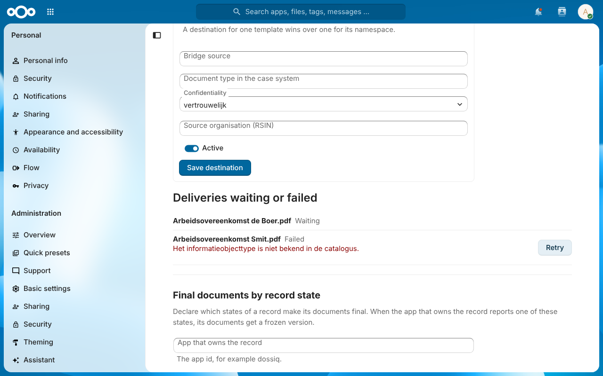

# Store a generated document in the case system

A letter generated for a case belongs in that case's file in the case system,
not only in Nextcloud. When a template or its namespace has a **case-system
destination**, every document generated from it and stored in Files also gets
a **delivery**. The ZGW bridge sends the delivery to the case system and
records the result on the delivery.

## Set up a destination

In **Administration settings → Filinq → Case system**, add a destination. A
destination names:

- the template, or the template namespace, it applies to; a destination for
  the template wins over one for its namespace;
- the bridge source it sends through;
- the case-system fields the document gets: `informatieobjecttype`,
  `vertrouwelijkheidaanduiding` and `bronorganisatie`.

Each template or namespace can have only one active destination. If you save
a second active one, the panel refuses it and tells you why.

A generation request can also name its own destination, for example a
`zaakUrl` for the case the document belongs to. That destination overrides
the template's for that one request.

## What a delivery does

A delivery is only made for a document that is stored. A request with output
mode `return` and a case-system destination gets `400`, because there is no
stored file to send. If the delivery cannot be written, the document is still
generated and stored, and the answer includes a warning.

A delivery moves through three states:

| State | Meaning |
| --- | --- |
| Waiting (`ready_for_writeback`) | The bridge has not sent it yet |
| In the case system (`written_back`) | The case system holds the document |
| Failed (`writeback_failed`) | The case system refused it; the error is on the delivery |

When a delivery fails, the person who generated the document is notified.

## See where a document went

- On **My Documents**, a stored document whose delivery was written back shows
  the badge **In the case system**. The listing asks once per page which of
  its files are delivered (`GET api/bridge/case-system/files`), and only
  about files the person can open.
- On **Reports → Documents produced**, two counters show how many deliveries
  are waiting and how many failed.
- The case-system section of the admin settings lists the waiting and failed
  deliveries, with the document and the error message.

## Retry a failed delivery

Fix what the error names, for example the destination's
`informatieobjecttype`, then choose **Retry** on the failed delivery. The same
delivery goes back to Waiting, without its error, and no second delivery is
made (`POST api/bridge/deliveries/{id}/retry`, administrators only). Only a
failed delivery can be retried; any other state answers `409`.

