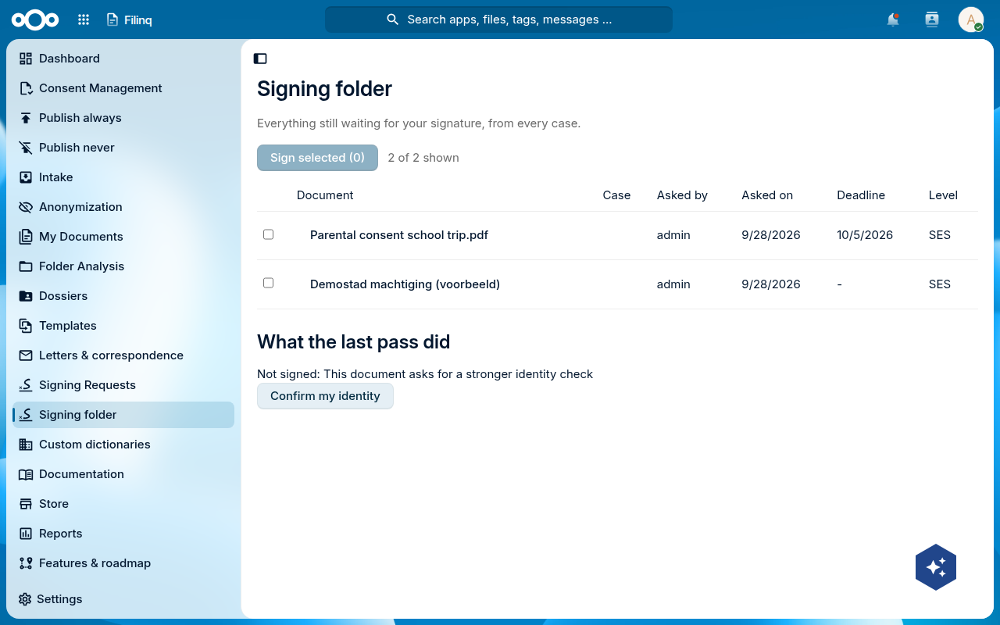
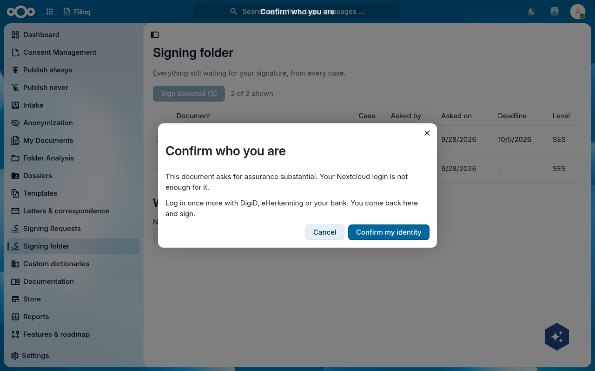
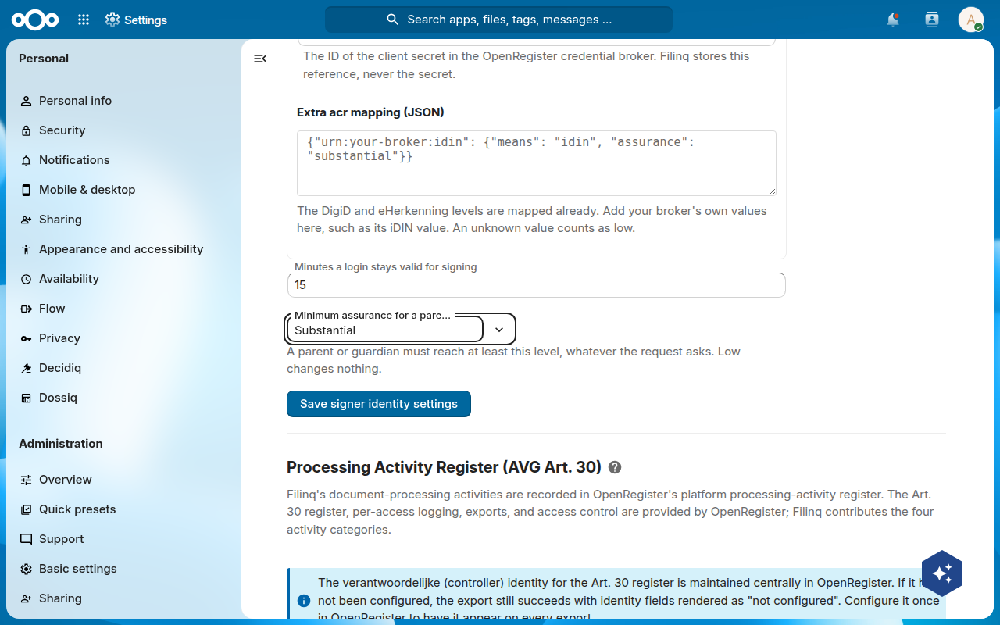

# Digital Signing Integration

Filinq provides a complete digital signing workflow — create signing requests, collect
signatures from multiple signers, verify document integrity, and maintain an immutable audit
trail. Signing can be performed natively within Nextcloud or delegated to an external provider
such as ValidSign.

## Overview

The signing feature supports:

- **Signing requests** — Create a request that routes a document to one or more signers
- **Signer actions** — Sign or decline; bulk signing for multiple requests
- **Cancellation** — Cancel an open request at any time
- **Verification** — Verify the signature integrity of a signed document
- **Audit trail** — Immutable log of all signing events per request
- **Pluggable providers** — Native (local) signing or ValidSign external service

## API Endpoints

### Create Signing Request

```
POST /apps/filinq/api/signing/requests
```

**Request body (JSON):**

| Field         | Type     | Required | Description                                              |
|--------------|----------|----------|----------------------------------------------------------|
| `fileId`      | int      | Yes      | Nextcloud file ID of the document to sign                |
| `signers`     | array    | Yes      | List of signer objects `{ userId, email, name, level }`  |
| `title`       | string   |          | Human-readable title for the request                     |
| `message`     | string   |          | Message shown to signers                                 |
| `dueDate`     | string   |          | ISO 8601 due date for completion                         |
| `provider`    | string   |          | Signing provider: `native` (default) or `validsign`      |

**Response:**

```json
{
  "id": "request-uuid",
  "status": "pending",
  "fileId": 42,
  "signers": [ { "id": "signer-uuid", "userId": "john", "status": "pending" } ],
  "createdAt": "2025-01-15T10:00:00Z"
}
```

---

### List Signing Requests

```
GET /apps/filinq/api/signing/requests
```

Returns all signing requests visible to the current user.

---

### Get Signing Request

```
GET /apps/filinq/api/signing/requests/{id}
```

---

### Cancel Signing Request

```
DELETE /apps/filinq/api/signing/requests/{id}
```

Cancels an open request. Any pending signers are notified.

---

### Sign Document

```
POST /apps/filinq/api/signing/requests/{id}/sign
```

Records a signature for the current user on the given request.

**Request body (JSON):**

| Field      | Type   | Required | Description                                    |
|-----------|--------|----------|------------------------------------------------|
| `signerId` | string | Yes      | UUID of the signer entry within the request    |
| `pin`      | string |          | PIN for native signing (if required)           |

---

### Decline Signing

```
POST /apps/filinq/api/signing/requests/{id}/decline
```

**Request body:**

| Field      | Type   | Required | Description                           |
|-----------|--------|----------|---------------------------------------|
| `signerId` | string | Yes      | UUID of the signer                    |
| `reason`   | string | Yes      | Reason for declining                  |

Declining goes through the request state machine like every other transition. A request
that is already `completed`, `cancelled`, `expired` or `declined` cannot be declined: the
call is refused before any signer or request is changed, and the stored status stays as it
was.

---

### Bulk Sign

```
POST /apps/filinq/api/signing/bulk
```

Sign multiple requests in a single call.

**Request body:**

```json
{ "requestIds": ["uuid-1", "uuid-2"] }
```

---

### Verify Document

```
GET /apps/filinq/api/signing/verify/{fileId}
```

Verifies signature integrity of a signed document file.

**Response:**

```json
{
  "fileId": 1234,
  "fileName": "contract.pdf",
  "verdict": "verified",
  "isValid": true,
  "signatures": [
    {
      "signer": "John Doe",
      "timestamp": "2025-01-16T09:00:00+00:00",
      "level": "SES",
      "method": "native",
      "status": "verified",
      "reason": "ok",
      "checked": "...",
      "keyId": "...",
      "means": "This server produced the document and its bytes have not changed since. ...",
      "valid": true
    }
  ],
  "verifiedAt": "2025-01-16T10:00:00+00:00"
}
```

Verification reports one of three states per signature, so tampering and "cannot be
checked here" are never confused:

| `status`       | `reason` (examples)                                   | Meaning                                                                 |
|----------------|-------------------------------------------------------|-------------------------------------------------------------------------|
| `verified`     | `ok`                                                  | This server signed it and neither the document nor the signer fields changed since |
| `invalid`      | `mac-mismatch`                                        | The document or its signature block changed after signing               |
| `unverifiable` | `legacy-assertion-v1`, `external-signature-unsupported`, `signing-secret-not-configured` | Nothing could be established; this is not evidence of tampering |

The native signature's MAC covers both the document content and the signature's own fields
(signer, timestamp, level, method, IP), so rewriting the signer's name in a signed file makes
it `invalid`. Signatures written before this format (`legacy-assertion-v1`) and PDF signatures
from other tools (`/Type /Sig`) are reported `unverifiable`, never `valid`.

The document-level `verdict` is `verified` (all verified), `tampered` (all invalid),
`unverifiable` (none checkable, or no signatures) or `mixed`. `isValid` and each
signature's `valid` are kept for older clients and are `true` only for `verified`.

---

### Get Audit Trail

```
GET /apps/filinq/api/signing/requests/{id}/audit
```

Returns the full audit trail for a signing request.

**Response:**

```json
[
  { "action": "docudesk.signing.CREATED", "user": "admin", "created": "2025-01-15T10:00:00+00:00", "changed": { "signRequestId": "..." } },
  { "action": "docudesk.signing.SIGNED",  "user": "john",  "created": "2025-01-16T09:00:00+00:00", "changed": { "signRequestId": "..." } }
]
```

Entries are OpenRegister audit-trail rows for this request only, oldest first.

---

## Signing Providers

Filinq uses a provider abstraction (`SigningProviderInterface`) to support multiple
backend signing implementations.

### Native Provider (`native`)

Signs documents within Nextcloud with the instance's signing key. No external service is
required. It produces only simple electronic signatures (`SES`); it refuses to produce an
artifact for any other level.

### ValidSign Provider (`validsign`)

Delegates signing to the ValidSign external service. Supports `SES`, `AdES` and `QES`.

**Required configuration:**

| Config key                         | Description                              |
|-----------------------------------|------------------------------------------|
| `filinq_validsign_api_url`       | ValidSign API base URL                   |
| `filinq_validsign_api_key`       | ValidSign API key                        |
| `filinq_validsign_sender_email`  | Sender email for invitation notifications|

Set via Filinq admin settings or:

```bash
docker exec nextcloud php occ config:app:set filinq filinq_validsign_api_key --value="your-key"
```

---

### Provider and level are checked, never substituted

- Creating a request whose provider does not support the requested level is refused with
  HTTP 400 before anything is stored (for example a `QES` request on the native provider).
- Completing a request never falls back to another provider: a request naming an unknown
  provider fails to complete loudly and stays `in-progress`.
- Each provider checks the level again when it produces the signed artifact.
- Downloading the result of a signing session requires a completed session with a produced,
  marked signed file. Otherwise the download fails; the unsigned original is never served
  as the signed document.

## Signature Levels

| Level | Name                                  | Description                                       |
|-------|---------------------------------------|---------------------------------------------------|
| `SES` | Simple Electronic Signature           | Click-to-sign; the only level the native provider produces |
| `AdES` | Advanced Electronic Signature        | Identity-linked; needs an external provider       |
| `QES` | Qualified Electronic Signature        | Legally equivalent to handwritten (eIDAS Art. 25); needs an external provider |

---

## Signers under the age of consent

A pupil of 14 cannot sign an ontwikkelingsperspectief (OPP) on their own. Filinq refuses
the signature until a parent or guardian stands beside them on the same request.

**The age.** Set it under *Settings > Digital signing > Guardian consent age*. The default
is 16, the age of consent in Dutch law (UAVG article 5). A request can raise it for its own
signers: send `guardianConsentAge: 18` on a praktijkovereenkomst (POK), because a student
under 18 is a minor under civil law. A request can never lower it.

**Naming the guardian.** Give each signer entry the extra fields below. The app that asks
for the signature knows the pupil's birth date and the parents, so it sends them.

| Field              | On                | Meaning                                                          |
|--------------------|-------------------|------------------------------------------------------------------|
| `birthDate`        | the pupil         | `YYYY-MM-DD`. Decides whether a guardian must sign too.          |
| `role`             | the guardian      | `guardian`. Every other entry is a `signer`.                     |
| `guardianFor`      | the guardian      | The `userId` or `email` of the pupil's entry in the same list.   |
| `guardianAct`      | the guardian      | `co-sign` (default): signs the document too. `consent`: agrees that the pupil signs. |
| `consentStatement` | a `consent` act   | The text the guardian agrees to. Required for `consent`.         |
| `guardianRef`      | the guardian      | Your own reference to the guardian, for example a learniq guardian id. |

**What Filinq checks.**

- A request that names a pupil under the age without a guardian is refused (400).
- The pupil's signature is refused (403) while no guardian on the request points at them.
- A guardian signs through the same sign action as anyone else, in Nextcloud or in the portal.
- A guardian cannot be the pupil, and cannot be under the age themselves.
- The age is checked at the moment the pupil signs, not when the request was made.
- The request completes only once a guardian has acted for every pupil under the age.

**What the signed document records.** The completed request and the signed file carry a
`consentBasis`: per pupil, the signer record, the age that applied, the moment it was
checked, and each guardian who acted, how, and how their identity was established. It never
carries the birth date. In the signed file the basis sits inside the signature seal, so
changing it afterwards makes verification fail.

**Who uses it.** learniq for the OPP and the POK, and portaliq for toestemmingsformulieren,
once they raise their signing requests through `DocumentSigningRequestedEvent`.

Next: set the guardian consent age for your school in the signing settings.

---

## Recipients who accept without signing

A recipient can be asked to accept a document instead of signing it, for example an officer who confirms a tenancy agreement the tenant signs. Give the entry `"role": "accept"` in the request's `signers` (or in the signer list of `DocumentSigningRequestedEvent`); every other entry signs.

```
POST /apps/filinq/api/signing/requests/{id}/accept
{ "signerId": "<the recipient's signer record id>" }
```

- An acceptance is recorded as `ACCEPTED` with `acceptedAt`, and the audit entry `ACCEPTED`. It never carries signature data: it is not a signature.
- An accept-only recipient cannot sign (422 "This document asks you to accept it, not to sign it"), and a signer cannot accept. Both may decline.
- A request completes when every signer has signed and every accept-only recipient has accepted. In sequential mode the order holds across both: a recipient placed after a signer acts after that signer.
- Accepting asks no signing mandate; the recipient check still applies.
- A request whose recipients all only accept is refused: nothing would be signed.

On `signerRecord`, `role` was already `signer` or `guardian`; `accept` is its third value, and no role signs as a party. A consumer that treats `status == SIGNED` as "done" should also count `ACCEPTED` for an accept-only recipient.

In the app:

- **New signing request**: every recipient row has a *Role*, *Sign* or *Accept only*. The form will not create a request without a recipient who signs.
- **Signing folder**: a document you only accept shows an *Accept* button instead of the selection box, and is never part of *Sign selected*.
- **Request detail**: the *Recipients* table lists each recipient in order with their role, state and when they signed or accepted. `GET /apps/filinq/api/signing/requests/{id}` returns that list as `recipients` (id, name, role, status, order, at); it holds no e-mail address, IP address or signature data.

On the portal, the signer manifest declares a third act, `accept`, beside `sign` and `decline` (`POST /apps/filinq/api/portal/signing/accept`, `minTrust: substantial`). The receiver checks the portal assertion and the invited recipient exactly as for signing. The wrong act for a recipient's role answers 422 `wrong_act` with the message above, on both the sign and the accept act.

## Signer identity: DigiD, eHerkenning and iDIN

A Nextcloud login tells Filinq which account is signing. It does not say how strongly that
person proved who they are. For a signature that needs more, a signer confirms their
identity once more through an identity broker, just before they sign.

**Assurance levels.** Filinq uses the three eIDAS levels: `low`, `substantial` and `high`.
Each signature level has a floor, and a request can ask for more but never less.

| Signature level | Assurance floor |
|-----------------|-----------------|
| SES             | `low`           |
| AdES            | `substantial`   |
| QES             | `high`          |

A QES request that asks for `low` is stored at `high`, and the create response says so in
`assuranceFloor`. A request made before this feature reads as `low`, so nothing changes for
it.

**What reaches which level.**

| Identity means                      | Assurance     |
|-------------------------------------|---------------|
| Nextcloud login                     | `low`         |
| DigiD Midden or Substantieel        | `substantial` |
| DigiD Hoog                          | `high`        |
| eHerkenning EH3                     | `substantial` |
| eHerkenning EH4                     | `high`        |
| iDIN (your broker's value)          | `substantial` |
| Portal signer                       | the portal's verified trust |

An unknown broker value counts as `low`, never higher.

**Connect a broker.** Under *Settings > Signer identity*:

1. Create the broker's client secret in the OpenRegister credential broker, on an inject-only
   provider, and allow the app `filinq`. Copy the credential's ID.
2. Fill in the issuer, the client ID, the authorization and token endpoints (https only) and
   the redirect URI `https://<your-cloud>/index.php/apps/filinq/api/signing/identity/callback`.
3. Paste the credential ID into *Credential reference*. Filinq stores this reference, never
   the secret, and refuses anything that is not a credential ID.
4. Add your broker's own iDIN value under *Extra acr mapping*. DigiD and eHerkenning are
   mapped already.
5. Choose *Identity broker* as the identity provider and save.

**Signing with a stronger identity.** When a request asks for more than the signer has, the
sign action answers 403 with a `stepUp` hint: the level needed and why. In the signing folder
the signer then chooses *Confirm my identity*, logs in at the broker, comes back on the
request and signs. A login stays valid for signing for 15 minutes by default; set another
window in the settings. It counts for that one request and signer only.





**Parents and guardians.** A request can ask more of a guardian than of the pupil: send
`guardianRequiredAssurance: substantial` and the parent confirms with DigiD while the pupil
signs with their Nextcloud login. An administrator can set a minimum for every guardian under
*Minimum assurance for a parent or guardian*.



**What is recorded.** Each signer record, its audit entry and the signed file carry the
identity evidence: provider, means, level, a pseudonym, the moment and a hash of the broker's
token. Filinq never keeps a BSN or the token itself; the subject is always hashed with a key
unique to your Nextcloud. The completed request carries the weakest level among its signers
as `resolvedAssurance`, and apps that asked for the signature receive that same value.

**EUDI wallet.** Every EU country must offer its citizens an EUDI wallet by December 2026,
with qualified signatures from a phone. Filinq does not ship a wallet integration today. The
identity seam is built so a wallet verifier can plug in as one more provider: it passes the
provider contract tests (`tests/unit/Service/SignerAuth/SignerAuthProviderContractTestCase.php`)
and registers, with no other change.

Next: connect your identity broker under *Settings > Signer identity*.

---

## Request State Machine

```
pending → in-progress → completed
                    ↓
                 declined
                    ↓
                cancelled
```

`isValidTransition()` enforces allowed state transitions.

---

## Audit Trail

`SigningAuditService` records every lifecycle event (created, signed, declined, cancelled,
viewed, ...) as an entry in OpenRegister's native audit trail (`openregister_audit_trails`).
Events are stored with action types of the form `docudesk.signing.{ACTION}` (e.g.
`docudesk.signing.SIGNED`). The prefix predates the rename to Filinq and is kept on purpose:
it is the value stored on every existing row, and the trail is read back by it.

Each entry is bound to the real signing-request object (its register, schema and id), so it
joins that object's hash chain. If the request no longer exists when the event is logged, the
entry is still written against the request's uuid and a warning is logged; an entry is never
dropped. The trail of a request is read with a query scoped to that request, not by scanning
all signing entries.

Immutability is OpenRegister's control: Filinq offers no way to change or remove an entry.
A live negative test against OpenRegister's audit-trail API (update and delete refused, chain
intact afterwards) is still open in `openspec/changes/signing-trust-rebuild` task 3.2.

Signing audit events are discoverable via:

```
GET /api/audit-trails?objectUuid={signRequestId}
```

### Supported action types

| Action type                      | Triggered when                    |
|----------------------------------|-----------------------------------|
| `docudesk.signing.CREATED`     | Signing request is created        |
| `docudesk.signing.START`       | Signer starts a signing session   |
| `docudesk.signing.SIGNED`      | Signer signs the document         |
| `docudesk.signing.DECLINED`    | Signer declines to sign           |
| `docudesk.signing.CANCELLED`   | Initiator cancels the request     |
| `docudesk.signing.EXPIRED`     | Request expires before completion |
| `docudesk.signing.COMPLETED`   | All signers have signed           |
| `docudesk.signing.VIEWED`      | Signer views the document         |

Each entry's `changed` JSON field carries: `signRequestId`, `actorUserId`,
`actorDisplayName`, `ipAddress`, `signatureLevel`, `provider`.

### Archiefwet 1995 retention configuration (required)

> **The signing register MUST keep its audit trail for at least 3650 days (10 years) to
> comply with Archiefwet 1995.**

OpenRegister gives each audit row an expiry taken from the retention of the object the row
describes. Signing audit rows are bound to the signing request, so their horizon is the
`signingRequest` schema's retention, read in this order: the schema's archive
`bewaartermijnOverride`, its archive `defaultBewaartermijn`, then the
`x-openregister-archival` annotation's `retention.default`. Filinq ships `signingRequest` and
`signerRecord` with `P10Y`. A schema with no retention at all keeps its rows indefinitely.

An administrator who changes that retention in OpenRegister can shorten it. Run the deploy
check after installing or upgrading, and after any retention change:

```bash
php occ filinq:signing:retention-check
```

It prints one line per signing schema (`signingRequest`, `signerRecord`) and exits non-zero
when either keeps its records for less than 3650 days, naming the signing register and
Archiefwet 1995. A schema that is not configured or cannot be read also fails, because its
retention has then not been verified.

The legal basis is **Archiefwet 1995**, which requires a minimum 10-year retention period
for signing audit records relating to official documents. Failure to configure this setting
may result in audit entries being purged before the mandatory retention period expires.

### Legacy signingAuditEntry records

Prior to the `migrate-signing-audit-to-or-audit` release, signing events were stored in the
`signingAuditEntry` OR schema. These records remain readable (read-only) for one major
release. No new events are written to `signingAuditEntry`; all new events go to OR's native
audit trail.

---

## Services

### `SigningService`

Orchestrates the signing request lifecycle.

| Method                   | Description                                      |
|-------------------------|--------------------------------------------------|
| `createRequest(data)`    | Validate and create a new signing request        |
| `getRequest(id)`         | Retrieve a signing request by ID                 |
| `listRequests()`         | List requests visible to the current user        |
| `sign(id, signerId)`     | Record a signature action                        |
| `decline(id, signerId, reason)` | Decline a signing request               |
| `cancelRequest(id)`      | Cancel an open request                           |
| `bulkSign(requestIds)`   | Sign multiple requests at once                   |
| `isValidTransition()`    | Check whether a status transition is allowed     |

### `SigningVerificationService`

| Method               | Description                                      |
|--------------------|--------------------------------------------------|
| `verifyDocument(fileId, userId)` | Verify signature integrity for a file|

### `SigningAuditService`

| Method              | Description                                      |
|-------------------|--------------------------------------------------|
| `logEvent()`        | Record a signing lifecycle event                 |
| `getAuditTrail(id)` | Retrieve all events for a signing request        |

### `SigningProviderFactory`

Resolves the configured signing provider instance.

### `SigningProviderInterface`

| Method                       | Description                                    |
|-----------------------------|------------------------------------------------|
| `getIdentifier()`            | Provider identifier string                    |
| `initiateSigning()`          | Start a signing session with the provider     |
| `checkStatus(externalId)`    | Poll external provider for signing status     |
| `downloadSignedDocument()`   | Retrieve the signed document binary           |
| `cancelSigning(externalId)`  | Cancel an external signing session            |
| `supportsLevel(level)`       | Check if provider supports a signature level  |

## Dependencies

| Dependency           | Purpose                                         |
|---------------------|-------------------------------------------------|
| `OpenRegister`       | Storage for signing requests and audit entries  |
| `INotificationManager` | Notify signers of pending requests           |
| `IUserSession`       | Identify the current signing user               |
| `IAppConfig`         | Read provider configuration                     |
