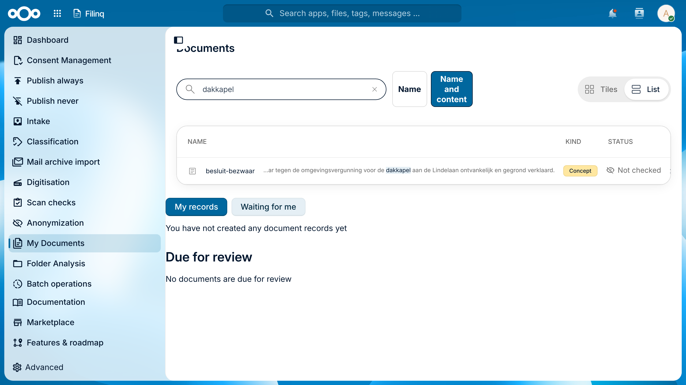

# Finding documents by their content

Filinq can find a document by the words in it, not only by its name. It
does not search on its own: OpenRegister reads the text of every document it
holds and answers a search over a list of files that filinq names. Filinq
asks only about files the reader may open, so a search never reveals a
document the reader could not have found otherwise.

## Where you can search

- **My documents.** Next to the search field, choose **Name** or **Name and
  content**. With Name and content, the list shows the documents whose name
  holds the words first, then the documents that hold the words in their
  text, best match first. Each content match shows a short passage with
  the words marked.

  
- **The documents of a record.** The documents card on a record (a case, a
  dossier, any object with documents) has a **Find in name and content**
  field that works the same way, for the documents of that record only.

## Documents that have not been read yet

OpenRegister can only find words in a document whose text it has read. When
some documents in the list have not been read, the page says so ("3
documents have not been read yet and cannot be found by content") and
offers **Read them now**. That asks OpenRegister to read those documents,
one after the other, and then runs the search again. A document you may not
open is never read on your behalf.

## When content cannot be searched

On an OpenRegister that does not offer the scoped content search, the page
says that only names were matched, and the result is the name search. It
never presents a name-only result as a full content search.

## For integrators

| Route | What it does |
|-------|--------------|
| `GET api/case-documents/files?mode=content&search=<words>` | The documents of one record whose name or content holds the words: name matches first (`match: name`), then content matches with their `snippet` (`match: content`); `content` says whether content was searched (`available`), how many listed files are unread (`unread`) and which (`unreadFileIds`). |
| `POST api/documents/content-search` | For a list of the caller's files (`{words, fileIds}`, at most 500 ids): which of them hold the words. Ids the caller may not read are left out before OpenRegister is asked. Answers `{available, hits: [{fileId, rank, snippet}], unread: [fileId]}`. |

The reading itself is OpenRegister's `POST /apps/openregister/api/files/{id}/extract`,
which checks that the caller may read the file.

Search words can be personal data. Filinq keeps none of them; what
OpenRegister's search trail keeps follows its own settings.
