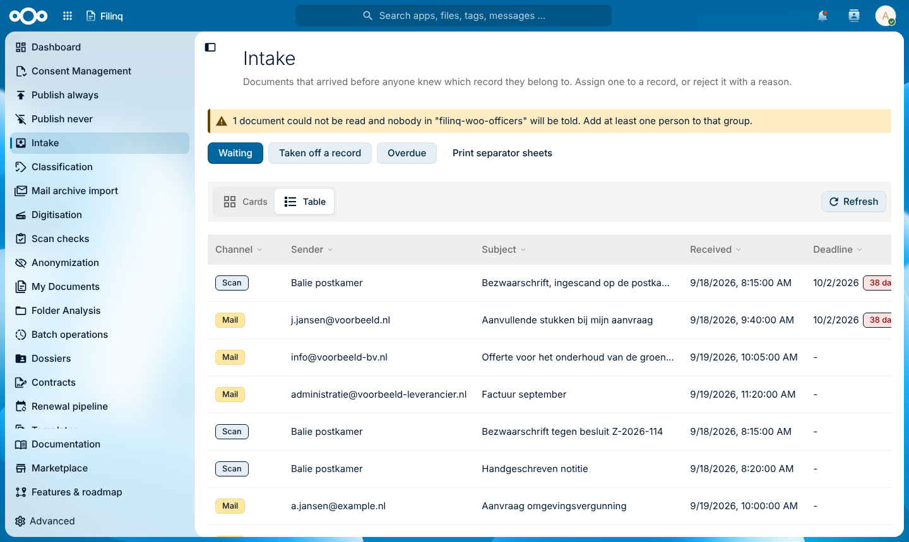

# Document intake inbox

A scanned letter, a mail attachment or a message from digital post often arrives before anyone knows which case it belongs to. Filinq keeps such a document in one inbox until a clerk files it on a record or rejects it. Nothing is lost in a personal mailbox or a scanner folder, and every document that left the inbox says who moved it, when and where to.

## What the clerk sees

Open **Intake** in the Filinq navigation. The inbox lists every document that is still waiting:

| Column | Meaning |
|---|---|
| Channel | Where it came from: *Scan*, *Mail* or *Digital post*. |
| Sender | The mail address, sender name or scanner that delivered it. |
| Subject | The mail subject, or the first line of a scan. |
| Received | When it arrived. |
| Text | Whether the text of a scan has been read (see [Reading scans on arrival](intake-ocr-on-arrival.md)). |

Select a document to see a preview of its file.

### Filing a document on a record

1. Select the document and choose **Assign**.
2. In **Assign to a record**, pick the register and the schema of the record, then **Pick a record**.
3. Confirm with **Assign**.

The document leaves the inbox. It now names the record it was filed on, who filed it and when. When the record keeps its own folder, the file is moved into that folder.

### Rejecting a document

Choose **Reject**. In **Reject this document**, give a **Reason** (for example *Not ours, no case here*) and confirm with **Reject**. A reason is required. The document leaves the inbox but is kept, with its reason, for the retention period of the document register.

### When filinq refuses

Filinq checks every assignment and rejection on the server, not only in the screen:

- you need write rights on the intake inbox to assign or reject;
- to assign, you also need write rights on the record you file onto;
- a document that someone else has already assigned or rejected cannot be moved again.

The screen then says *The assignment was refused.* or *The rejection was refused.* and the document stays where it was.

## The inbox on another app's record

Filinq also offers the inbox as a widget and a tab, `filinq-document-intake`, that another app can place on its own record pages, for example a case in Dossiq. The widget lists the waiting documents, those whose source reference names the record first, and files one onto that record through Filinq's own assignment. The other app only reads the result: the document's *assigned to* field.

## Where documents come from

Every channel hands its document to Filinq in the same way: it announces the document, and Filinq creates a waiting intake document for it. A channel never files a document on a record itself. Mail and digital post arrive through Integriq; paper arrives through the scanner intake (see the separator-sheet scanning documentation).

## For developers

- Schema: `intakeDocument` in the `document` register, with the lifecycle `received` → `assigned` or `rejected`.
- API: `GET /api/intake/documents` (waiting documents), `POST /api/intake/documents/{uuid}/assign` with `register`, `schema` and `id` (add `withAttachments: true` to file a mail together with its attachments), and `POST /api/intake/documents/{uuid}/reject` with `reason`.
- Feeders dispatch `OCA\Filinq\Event\IntakeDocumentReceivedEvent`; Filinq's listener calls `IntakeService::receive()`.
