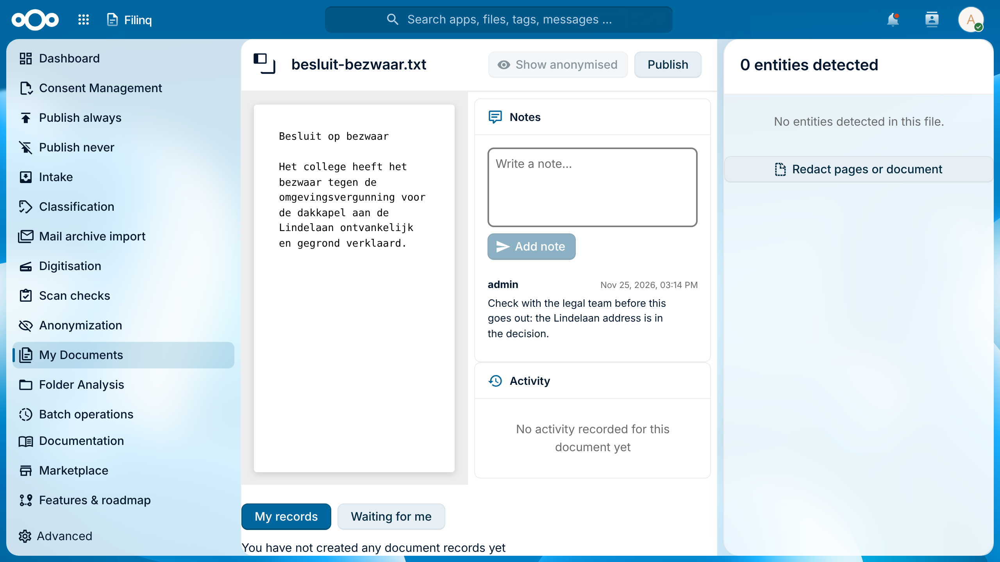

# Notes on a document

A note is a line for a colleague about one document: "Check with finance
before assigning", "Annex 2 is missing, asked the supplier". Filinq keeps
no notes of its own. A note is a Nextcloud comment on the document's file,
so the same note shows in the Files sidebar, a colleague named with @ gets
a notification, and Nextcloud's search finds it.

## Where the notes are

- **My documents.** Open a document: the Notes panel sits beside it. Read
  the notes, write one and choose **Add note**, delete your own. Each row
  in the list shows how many notes its document has.
- **A dossier.** Each document of a dossier shows only its own notes.
- **The intake worklist.** The **Notes** row action opens the notes of
  that letter, with their author and time.

## Who reads them

Who can read or add a note follows who can open the file. A colleague the
file is shared with reads its notes, in filinq and in Files; someone who
cannot open the file sees none.

## A note stays on its file

A note belongs to one file. An anonymised copy, a merged PDF, a share link,
a bundle and a generated document are other files and carry no notes;
filinq never copies notes onto them. This keeps a note written about a
person out of a Woo publication. Someone who opens a share link gets the
document, never its notes.
