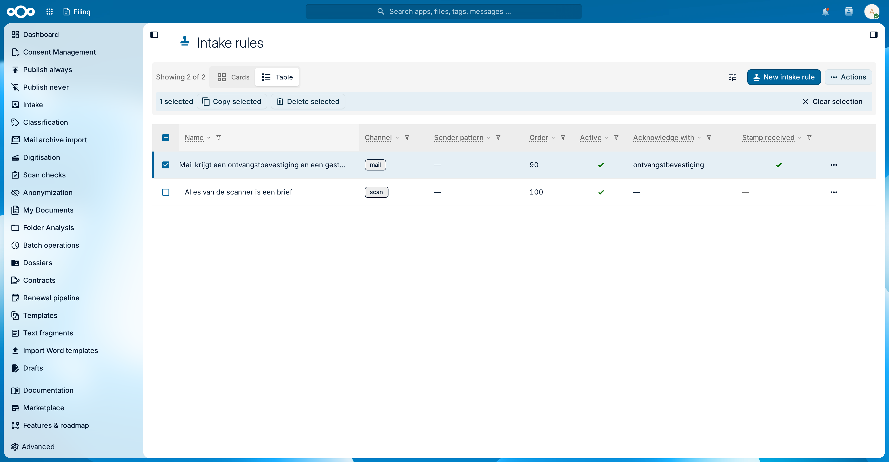
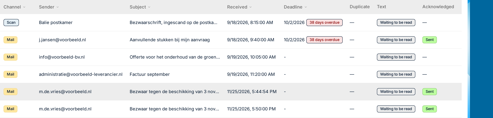

# Acknowledge receipt and stamp arriving documents

When a document arrives in the intake inbox, two things can happen without
anyone doing them by hand: the sender is told it arrived, and a copy of the
document gets a visible **Ontvangen** stamp with the date. An **intake rule**
decides both, per channel and sender. Nothing here can refuse or undo an
arrival: the document is saved first, and only then are the sender told and
the copy stamped.

## Set it up on an intake rule

Open **Intake rules** in the settings section of the navigation. Only
administrators can change a rule. Next to the channel, the sender pattern and
the order, a rule has two fields:

- **Acknowledge with**: the template the acknowledgement is rendered from.
  Empty means no acknowledgement. The template receives the subject, the
  sender, the received date, the channel and, when the document was entered
  in the post register, its registration number.
- **Stamp received**: whether an arriving PDF (a scan is a PDF) gets a copy
  with the stamp on its first page.

## How the sender is reached

In this order:

1. A party linked to the document as sender is written to at its
   correspondence address. A party that refused contact is not written to,
   and the document records **Refused** with the reason.
2. A document that came in by mail is answered at the sender's e-mail address.
3. Anyone else gets a letter: the acknowledgement is rendered as a PDF and
   stored in Files for the outgoing post, and the document records
   **Queued as letter**.

When the arrival has an inbound entry in the post register, the
acknowledgement carries its number, and the acknowledgement is itself
registered as the outgoing entry that answers it.

A send that fails, for example because the server's mail is not configured,
records **Failed** with the reason. The document stays in the inbox as it
arrived.

The mail is plain text: the rendered template's paragraphs become lines, and
the received date reads as day-month-year (25-11-2026). The intake inbox shows
the outcome in its **Acknowledged** column.

## The stamped copy

The copy is written next to the arrived file as `<name> (ontvangen).pdf`, with
"Ontvangen", the received date and the registration number when there is one
in the top right of page 1. The arrived file is never changed: its bytes and
checksum stay as they arrived. A file that is not a PDF is not stamped.

## In the intake worklist

The **Acknowledged** column shows Sent, Queued as letter, Refused or Failed;
hover it for the reason or the address. A document no rule acknowledged shows
nothing. When a stamped copy exists, the row's menu offers **Open stamped
copy**.
