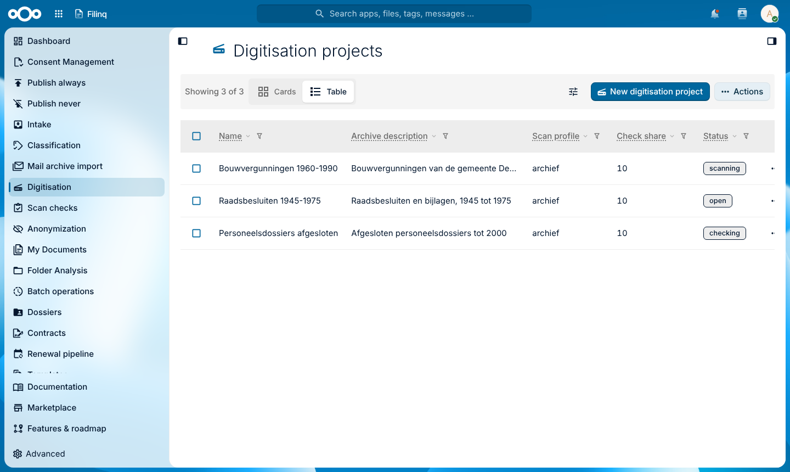

# Digitising a paper archive

A paper archive is digitised box by box. Every paper original gets a record,
every scan knows which original it copies and is filed on the project's
record, and a share of the scans is checked against the paper by a person.
What happens to the paper afterwards is OpenRegister's archiving process.

## The project

Open **Digitisation** in the menu and create a project. A project names:

- the archive it digitises and its boxes;
- the scan profile its separator sheets are printed for;
- the record the scans are filed on (typically a dossier), as register,
  schema and id;
- the share of scans a person checks, from 0 to 100 percent (10 by default).

The project page shows, per box, how many originals are registered,
scanned, checked and rejected. An original whose scan was rejected counts as
rejected until it is scanned again.

## Registering the originals

Register originals one by one, or choose **Import box list** on the project
page and paste a CSV with the columns:

| column | required | what |
|---|---|---|
| `box` | yes | the box as written on it |
| `shelfMark` | yes | the original's shelf mark |
| `description` | no | what the original is |
| `dateFrom`, `dateTo` | no | the period it covers, stored as `dateFrom-dateTo` |

The list may use commas or semicolons and holds at most 5000 rows. Every row
becomes a `registered` original of the project, saved with your own rights.
A row without a box or shelf mark, with the wrong number of cells, or that
you may not create is listed with its line number and reason; the other rows
are imported.

## Separator sheets

On the project page, **Print separators for this box** downloads one sheet
per original of that box. Each sheet prints the original's shelf mark and
description and a QR code naming it
(`filinq:sep:v2:<profileId>:po:<original>`), so the scan operator can check
it before it goes into the scanner. The older sheets that name a case keep
working.

## Scanning

When a batch is split, a segment that follows a sheet naming an original is
filed in the folder of the project's record, named after the shelf mark and
description, and does not enter the intake inbox. The original records the
file, the batch and when it was scanned. A segment after an ordinary sheet
goes to the intake inbox as before.

## Checking

Each scanned original is drawn into the checking queue with the project's
check share, and always when its separator could not be read or the scan has
no pages. An original the sample does not draw is recorded as passed by
`sample-not-drawn`, so the record says nobody looked at it.

**Scan checks** in the menu lists the originals waiting for a check. Open
one, choose **Open scan** to compare it with the paper, then:

- **Pass**: the original is checked;
- **Reject** with a note saying what is wrong: the original goes back to
  registered to be scanned again, and its box counts one rejected.

## API

| verb | path | what |
|---|---|---|
| GET | `/api/digitisation/projects/{id}/boxes` | the originals counted per box and state |
| GET | `/api/digitisation/projects/{id}/separators?box=` | the separator sheets of one box (PDF) |
| POST | `/api/digitisation/projects/{id}/originals/import` | import a CSV box list (`csv`); 422 lists failed rows |
| POST | `/api/digitisation/originals/{id}/check` | pass or reject a scan (`result`, `note`) |

Every endpoint reads and writes with the caller's own OpenRegister rights.

Screenshots follow once the pages have been captured on a running instance.
