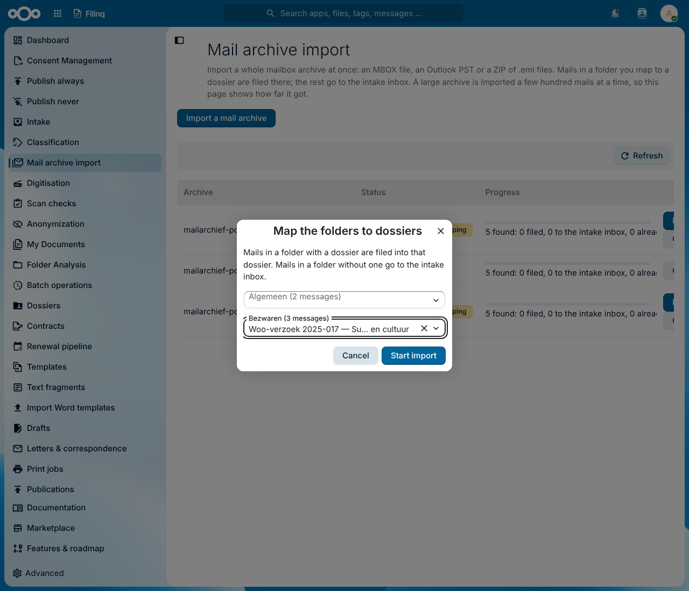
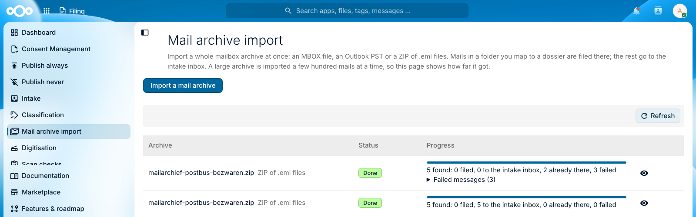

# Import a mailbox archive

When an organisation leaves a shared mailbox, or the mailbox of an official who leaves has to be kept, IT usually hands over one file: an MBOX export, an Outlook PST, or a ZIP of `.eml` files. Filinq imports that file in one go. Mails in a folder you map to a dossier are filed into that dossier, the same way [email ingestion](email-ingestion.md) files a single `.eml`. Mails in the other folders go to the intake inbox, where a person sorts them one by one.

Filinq reads the file you already have in Nextcloud Files. It does not connect to a mailbox, and no message goes to an outside service.

## Start an import

1. Put the archive in your Files.
2. Open **Mail archive import** in the menu and click **Import a mail archive**.
3. Pick the file. Filinq works out whether it is an MBOX, a PST or a ZIP, and counts the messages in each folder.
4. In **Map the folders to dossiers**, pick a dossier for each folder whose mail belongs to one. Leave a folder on **Intake inbox** when its mail is mixed.
5. Click **Start import**.

You can only pick dossiers you may write to. If one of them is not, the whole mapping is refused and nothing is imported yet.

## How the import runs

A large archive is not imported in one request. A background job, running with the rights of the person who started the import, takes a few hundred messages every five minutes (**Messages per run** in the admin settings, default 200) and saves where it stopped. When the server restarts halfway, the next run carries on from that point.

The page shows for each import:

| Column | What it shows |
|---|---|
| Archive | The file name and the format Filinq detected |
| Status | Waiting for the folder mapping, Importing, Done, Failed or Cancelled |
| Progress | A bar, the number of messages found, filed, sent to the intake inbox, already there and failed, and the list of failed messages |

You get a Nextcloud notification when an import is done or has failed. **Cancel import** stops an import; what was already filed stays filed.

## Nothing is filed twice

A message that is already in the dossier, by its content or its Message-ID, is counted as **already there** and not filed again. A message whose Message-ID is already in the intake inbox is not received again either. Importing the same archive twice with the same mapping files nothing the second time.

## Formats

| Format | How Filinq reads it |
|---|---|
| MBOX (mboxrd and mboxo) | Read straight from the file, one message at a time. The archive is one folder, named after the file |
| ZIP of `.eml` files | One entry per message; the folders in the ZIP are the archive's folders |
| Outlook PST | Converted on the server with `readpst` (libpst), then read like a ZIP |

The admin settings under **Mail archive import** show whether `readpst` is installed. Without it a PST import fails at once with "readpst is not installed on this server"; MBOX and ZIP imports keep working.

## When a message cannot be imported

The import goes on and the message shows in the failure list with the reason:

| Reason | What to do |
|---|---|
| Not an `.eml` message (an Outlook `.msg`) | Export it again as `.eml` and drop it in a watched inbox |
| Not readable as an email | Export it again from the mail program |
| The dossier has no folder that can be reached | Check the folder of the dossier |
| The message could not be stored | Check the permissions of the dossier folder |

The failure list holds the folder, the file name and the Message-ID, never the content of the message.

## Where the files go

Each message is written as an `.eml` into a folder beside the archive, named after it with ` (mail import)`, in a subfolder per archive folder. A mapped message then moves into the dossier folder and gets a PDF copy and an email record, as email ingestion does. An inbox message stays there and is linked from the intake inbox.

## API

| Route | Who | What it does |
|---|---|---|
| `GET /apps/filinq/api/mail-archive-imports` | Signed-in user | The user's own imports, newest first |
| `POST /apps/filinq/api/mail-archive-imports` | Signed-in user | Start an import of `fileId`, a file the user can read; answers the import with its folders |
| `GET /apps/filinq/api/mail-archive-imports/{uuid}` | The user who started it | One import with its counts and failures |
| `POST /apps/filinq/api/mail-archive-imports/{uuid}/start` | The user who started it | Map the folders (`folderMap` of `{archiveFolder, dossier}`) and start importing; 403 for a dossier the user may not write to |
| `POST /apps/filinq/api/mail-archive-imports/{uuid}/cancel` | The user who started it | Cancel an import that has not ended |
| `GET`/`PUT /apps/filinq/api/mail-archive-imports/settings` | Admins | Whether `readpst` is installed and the messages per run |

An import of another user answers 404.

Next: put a small MBOX export in your Files and import it to see how the folders and counts look.
