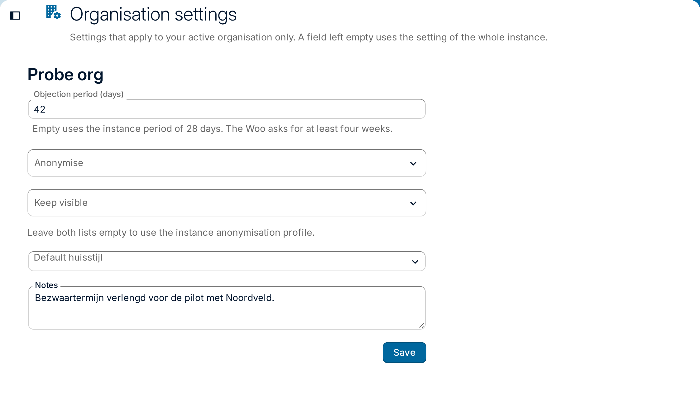

# Multiple organisations on one instance

## Status: In progress

Several organisations can work in one Filinq instance without seeing each other's work. Filinq
does not hold its own notion of a tenant: an organisation **is** an OpenRegister organisation, and
OpenRegister decides what each user may see.

## Where the boundary lives

Every Filinq object (a consent, a prohibition, a signing request, a template, a huisstijl, a
dossier, a batch, a letter) is an OpenRegister object. OpenRegister stamps a new object with the
creator's active organisation and filters every read by it. Filinq never writes that stamp and no
Filinq schema has an organisation property.

Filinq calls OpenRegister with its enforcement on. The few places that must see across
organisations, such as applying every publish-never rule to an anonymisation, go through one
logged system operation that records why and from where it ran. A test guards the source tree:
a service this change cleared cannot regain a bypass, and no new cross-organisation read can be
added outside that system operation. The places that predated this work, each with its own
compensating control, are listed in `docs/authorization-decisions.md`.

When no active organisation can be resolved, Filinq shows nothing rather than everything.

## Organisation settings

Some settings are policy per organisation. An organisation can override them on the
**Organisation settings** page (in the settings foldout of the Filinq navigation):

| Setting | Empty means |
|---|---|
| Objection period (days, 1–365) | the instance period (admin settings, 28 days by default) |
| Anonymisation profile: categories to anonymise and to keep visible | the instance anonymisation profile |
| Default huisstijl | the organisation's only huisstijl if it has exactly one, else neutral styling |

Every member of the organisation can read the page. Only an admin of the organisation, or an
instance admin, can save it.

Filinq resolves each of these settings in one order: the active organisation's value, then the
instance setting, then the built-in default. New consent records take their objection deadline from
the result, the anonymisation entity review pre-selects from the resulting profile, and document
generation uses the resulting huisstijl. An organisation without overrides behaves exactly as
before.

Instance-wide settings (OpenRegister wiring, enrichment, the signing provider) stay instance-wide.

## Reports

A batch report names the organisation its batch belongs to (name and identifier) on every row.
Dashboard counters count the active organisation's objects only.

## Upgrading an existing installation

Objects created before OpenRegister stamped organisations carry no organisation. On upgrade, a
repair step hands Filinq's objects without an organisation to OpenRegister's default
organisation, using OpenRegister's own adoption tooling, so a single-organisation installation
keeps seeing its data. It changes nothing else on the object, skips sealed signing audit entries,
logs how many objects of each schema it adopted, and does nothing on a second run. An instance
with several organisations reviews that log and moves objects to the right organisation with
OpenRegister's tooling.
