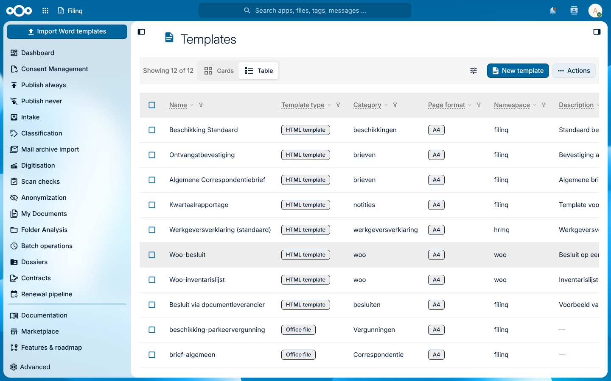
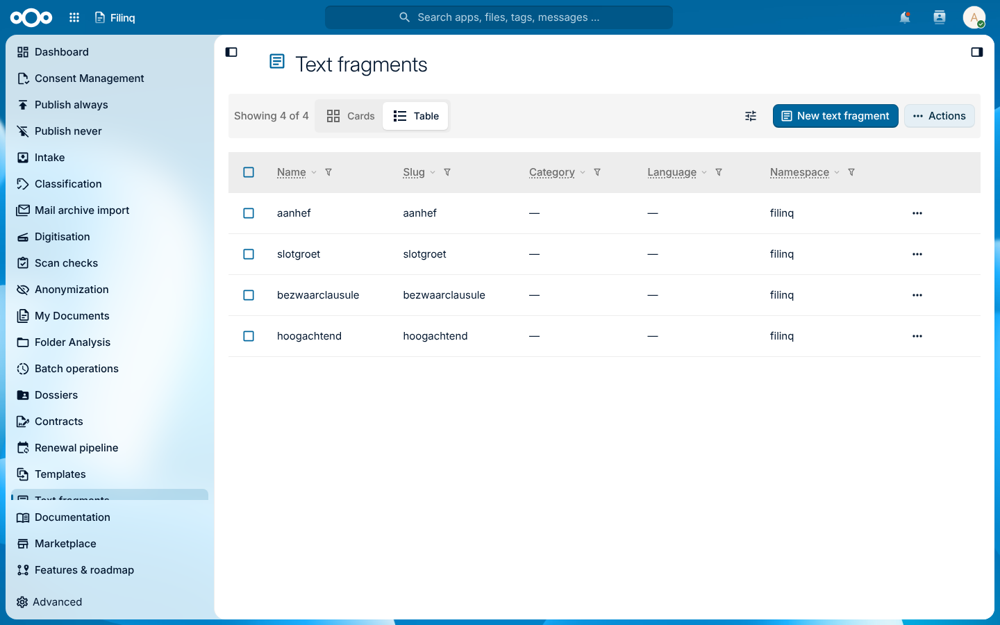
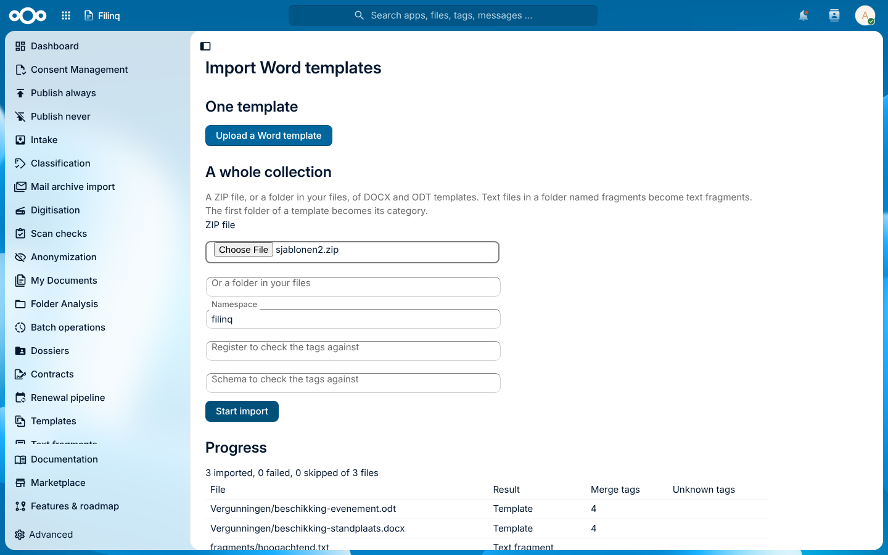

# Word and ODT templates, text fragments and bulk import

## Overview

Most organisations already have their letters and decisions as Word files.
Filinq takes those files as they are: a DOCX or ODT becomes a template of type
**Office file**, next to the HTML templates, and generates documents from it
through the same pipeline. Standard text that recurs in many templates, such
as a salutation or an objection clause, lives once as a **text fragment**. A
whole collection of templates and fragments can be imported in one go.

## Merge tags

An office template marks the places Filinq fills with `${...}` tags:

| Tag | What it does |
|---|---|
| `${aanvrager.naam}` | A field of the record the document is made for. Dotted paths reach nested fields. |
| `${block}` … `${/block}` | A repeating region, filled once for each item of a list. |
| `${fragment:slotgroet}` | A text fragment, by its slug (see below). |

When a template is uploaded, Filinq reads all its tags and stores them on the
template. A field without a value in the data renders empty, and the
generation result names the tag in its warnings, so nothing goes missing
silently. Filling runs no logic from the template and makes no network call.

## Uploading one template

**Import Word templates → Upload a Word template** takes one DOCX or ODT file.

- An **ODT** is converted to DOCX when it is uploaded; the original ODT is kept
  and the upload says that it was converted.
- A file with **macros** (`.docm`, `.dotm`, or a DOCX that contains
  `vbaProject.bin`) is refused, as is a file over the size limit or one whose
  content does not match its extension.

### Checking tags against a schema

A template can be bound to an OpenRegister register and schema. Its tags are
then checked against that schema's properties on every upload:

- `known`: the tag matches a property, or a dotted path inside one;
- `fragment`: the tag starts with `fragment:`;
- `unknown`: anything else, for example a typo such as `${aanvraagr.naam}`.

By default an unknown tag is a warning on the template. An administrator can
make it blocking (`filinq.templates.unknown_tag_severity` set to `blocking`);
the upload is then refused and lists the unknown tags. A template without a
binding is never blocked, and its report says that no schema check was done.

## Text fragments

**Text fragments** holds reusable standard text: a name, a slug that is unique
within its namespace, the content, and optionally a category, tags and a
language. A template, office or HTML, includes a fragment with
`${fragment:<slug>}`. Fragments are resolved before the fields are filled, so
a fragment may itself contain `${field}` tags (one level; a fragment cannot
include another fragment). A fragment that does not exist shows as
`[ontbrekende bouwsteen: <slug>]` in the document and as a warning, never as
a silent gap.

## Importing a whole collection

**Import Word templates → A whole collection** takes a ZIP file, or a folder in
your files, with DOCX and ODT templates:

- every office file becomes an office template, with its tags read and checked
  as above;
- the first folder a template is in becomes its category (`Vergunningen/…`
  gives the category *Vergunningen*);
- text files in a folder named `fragments` become text fragments, named after
  the file.

The import runs as a background job, so a collection of hundreds of templates
does not block the page. The page shows progress and, per file, the result,
the number of merge tags and any unknown tags. A file that fails is reported
and skipped; the rest of the collection is still imported.

Unknown tags in imported templates can be mapped to schema properties
afterwards in the template's wizard. The mapping is stored on the template
and used when it is filled.

## Generating documents

Office templates generate through the same routes as HTML templates
(`documents/generate`, preview and bulk). The output is the filled DOCX, or a
PDF or PDF/A converted from it by the conversion backends. Every generated
document is logged with the template, its version and its type.

## API

| Method | URL | Description |
|--------|-----|-------------|
| POST | `/api/templates/office` | Upload one DOCX or ODT as an office template (multipart) |
| POST | `/api/templates/import` | Start a bulk import from a ZIP or a folder |
| GET | `/api/templates/import/{jobId}` | Progress and per-file report of an import |
