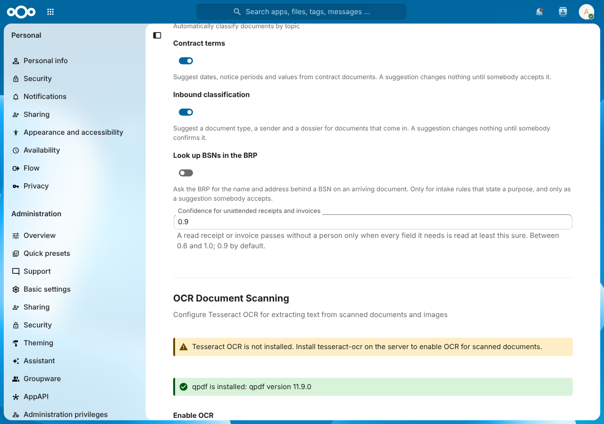

# Capturing receipts and invoices, and the unattended verdict

An employee photographs a receipt or an invoice, usually from shillinq's
receipt screen on a phone. Filinq stores the photo in the employee's own
Files, reads it, and says whether the result is good enough to book without a
person looking at it.

Spec: `openspec/specs/receipt-photo-capture` (REQ-ERP-001, REQ-ERP-002) and
`openspec/specs/financial-document-field-extraction` (REQ-ERP-003 to
REQ-ERP-005).

## The capture route

```
POST /apps/filinq/api/extraction/capture
multipart: file, docType (receipt | supplier-invoice), sourceApp, callbackEvent
```

Any signed-in user can call it. In one call it:

1. checks the file from its bytes: JPEG, PNG, HEIC or PDF, up to 20 MB;
2. turns a photo upright from its EXIF orientation, and converts HEIC to JPEG
   when the server can;
3. stores it in the caller's Files under `Receipts/<yyyy>/<mm>/`;
4. reads it exactly as `POST api/extraction/financial` does, and answers
   **201** with the stored `financialExtraction`, whose `capturedFileId` names
   the photo.

What it refuses, before anything is stored:

| Answer | When |
| --- | --- |
| 413 | The photo is larger than 20 MB. |
| 415 | The bytes are not a photo or a PDF (a ZIP named `bon.jpg`, for example), or the upload policy refuses the type. The answer gives the reason. |
| 415 | A HEIC photo on a server that cannot convert it: "This photo format cannot be read on this server. Take the photo as JPEG." |

A photo with nothing readable on it, such as one taken on a server without OCR,
is still stored and answered. Every field is then empty at confidence 0.0, and
the verdict is `review`.

## The unattended verdict

Every extraction gets a verdict, stored on it with the threshold it used:

- `unattendedVerdict`: `pass` or `review`
- `verdictReasons`: one code per failed check
- `verdictThreshold`: the threshold at the time; a later change of the setting
  does not change a stored verdict

The verdict is `pass` only when the supplier's name, one supplier identifier
(IBAN, KvK or VAT number), the issue date and the total are all read at or
above the threshold, the totals add up, no field was filled by the model
alone, and no earlier extraction has the same supplier identifier and invoice
number.

| Reason | Meaning |
| --- | --- |
| `missing-field` | A field the verdict needs was not read. |
| `low-confidence` | A needed field was read below the threshold. |
| `not-reconciled` | Excluding VAT plus VAT does not make the total. |
| `model-only` | A field was filled by the language model and not found in the text. |
| `possible-duplicate` | An earlier extraction has the same supplier identifier and invoice number. |

When `callbackEvent` is true, Filinq first sends the
`nl.conduction.filinq.extraction.completed` event it always sent, unchanged,
and then `nl.conduction.filinq.extraction.verdict` with `extractionId`,
`documentUri`, `sourceApp`, `docType`, `verdict`, `reasons` and `threshold`.
shillinq acts on the verdict. If the verdict event cannot be sent, Filinq
logs it and the extraction still succeeds.

## Setting the threshold

In **Administration settings → Filinq**, **Confidence for unattended receipts
and invoices** sets how sure every needed field must be. It is 0.9 by default
and takes values from 0.6 to 1.0. Anything else is refused with "Choose a value
between 0.6 and 1.0."


