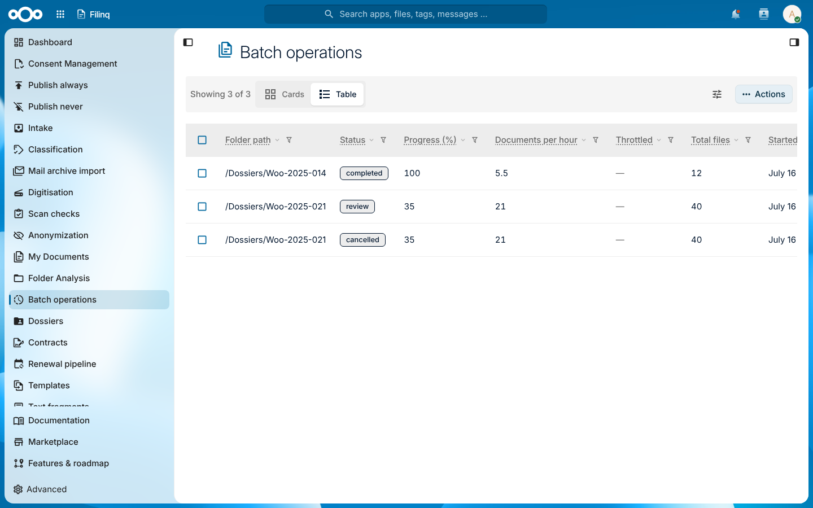
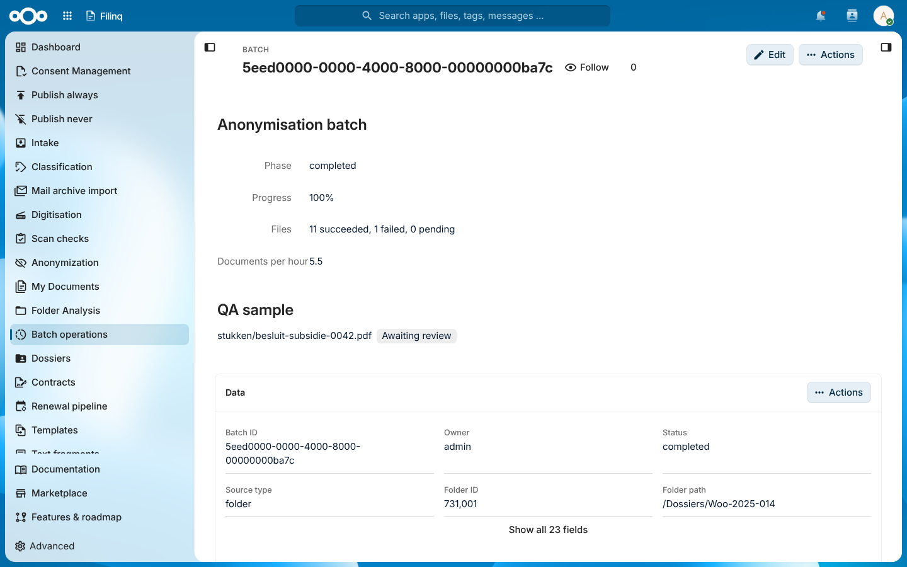
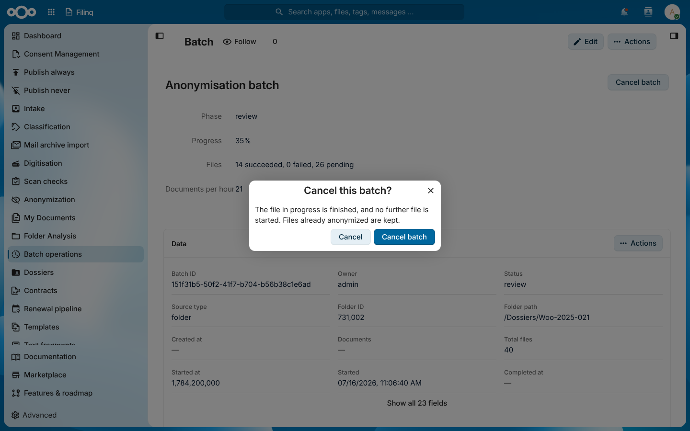
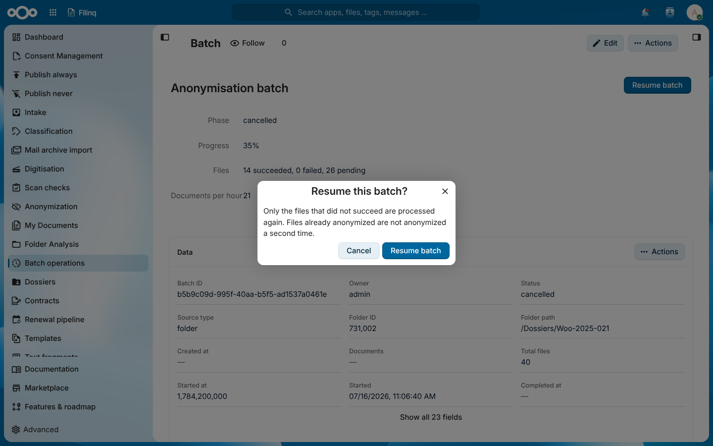

# Redaction at scale

## Overview

Large anonymisation batches (a dossier folder of hundreds of documents) are
not processed inside one HTTP request. Above the synchronous cap a batch is
handed to a cron coordinator that works through it in small, bounded work
units, writes its state after every file, and can be followed, cancelled and
resumed from the **Batch operations** page.

## Which path a batch takes

| Batch size | Path |
| --- | --- |
| up to `batch.max_files_per_run` (default 100) | in-request, as before |
| above that, up to `batch.max_files_background` (default 1000) | background work units |
| above the background cap | refused with HTTP 400 naming the maximum |

Folder batches are routed when they are created (`POST
/api/anonymization/batch/folder`, optionally with `recursive: true` to include
every subfolder; each file then records its `relativePath`). The anonymize step
(`POST /api/anonymization/batch/{batchId}/anonymize`) of a batch above the
synchronous cap stores the reviewed entity list on the batch and answers
**202** with the status location; the files are anonymized in the background
with the same pseudonym for a person across the whole batch.

Set `batch.engine` to `legacy-sync` to switch the background path off: the
synchronous cap is then the only cap, as before.

## Work units

The coordinator (`BatchJobCoordinator`) runs every five minutes, never in
parallel with itself, and gives the oldest background batch with work left one
work unit: at most `batch.files_per_tick` files (default 25) and at most
`batch.seconds_per_tick` seconds (default 120), whichever ends first.

- A file is never interrupted: the time budget is checked between files.
- A cancel (`POST .../cancel`) is honoured between files; outputs already made
  are kept.
- A LibreOffice conversion that finds its lock taken is retried in a later unit,
  at most three times, before the file counts as failed
  (`conversion-lock-timeout`).
- A unit that spends its time budget on fewer than 20% of its file budget marks
  the batch **throttled**, so a slow batch is visible rather than silent.
- A resume (`POST .../resume`) of an errored or cancelled batch requeues only the
  files that did not succeed; a file whose redacted copy was made after the
  batch started is taken from its `anonymizationLink` instead of being
  anonymized again.
- A completed batch whose files failed can be resumed as well: only its files
  in `error` are queued again, and every other file keeps its outcome. A
  completed batch without failed files cannot be resumed.

## Progress and report

Every write of a batch carries its succeeded, failed and pending counts, the
percentage done in the current phase and the documents per hour since it
started. The batch report adds failures grouped by reason and per-phase
durations; entity values are never in it.

On completion a reproducible sample of `batch.qa_sample_rate` percent (default
5, at least one file) of the anonymized files is marked for human review. A
sample's outcome comes from its `documentReview`: none yet is *pending*, a
review that added manual entities is *corrected*, otherwise *confirmed*. A rate
of 0 switches sampling off and the report says so.

## The batch operations view

*Batch operations* in the menu lists the batches you may see: your own, or
every batch for a policy admin or an admin. Each row shows the phase, the
progress, the documents per hour, the throttled flag and when the batch
started.

A row opens the batch, with its counts and the QA sample. Each sampled file
carries its review outcome.

A batch that is still running or waiting for review can be cancelled: the
file in progress is finished, and no further file is started. A cancelled or
failed batch can be resumed: only the files that did not succeed are
processed again. A completed batch with failed files offers Resume too, and
then only the failed files are processed again. Both actions ask for confirmation first.

## Sizing

Throughput is bounded by the cron cadence: with the defaults one instance does
at most 25 files per five minutes, about 300 documents per hour, when every
file fits the budget. A yearly volume of 55,000 documents (about 220 per
working day) fits within one working hour per day. Raise
`batch.files_per_tick` when files are small and the instance is quiet; raise
`batch.seconds_per_tick` when files are large and units end on the time budget
(the throttled flag tells you). Lower both when other background jobs are
delayed.
