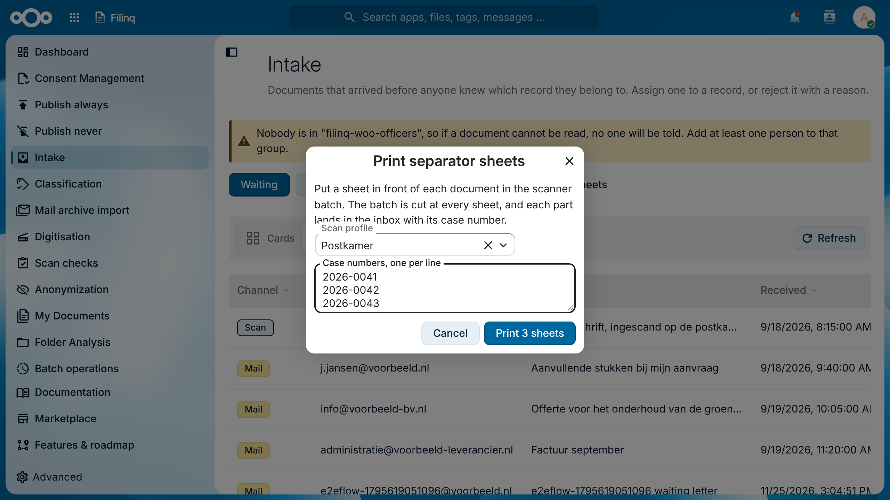
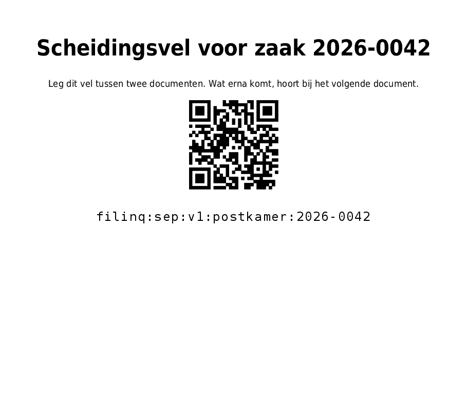
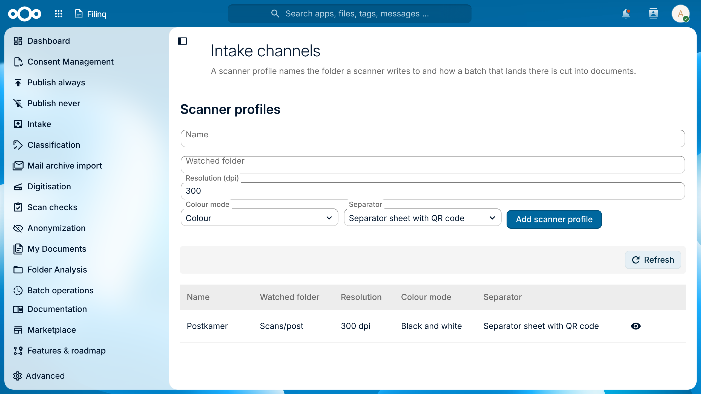

# Scan intake

A scanner writes one PDF per batch. Filinq cuts that batch into its documents at the separator sheets and puts every document in the [intake inbox](./document-intake.md). A scan profile says which folder a scanner writes to and how its batches are cut: at a QR separator sheet, at a blank page, or not at all (one document per batch).

## Separator sheets

On the intake page, **Print separator sheets** prints one sheet per case number for a profile. A sheet carries a QR code and the same text in print. When the batch is cut, the case number on the sheet pre-fills the assign picker of the document that follows it.

The splitter reads the printed text under the QR code. Text recognition misreads it in a few fixed ways ("filing" for "filinq", "vl" for "v1", a space after a colon, a long payload broken over two lines); Filinq puts those back before it reads the case number, so a sheet is still found.

## Scanner profiles

An administrator adds the profiles under **Intake channels**: a name, the folder the scanner writes to, the resolution, the colour mode and how a batch is cut.

## From a watched folder

A scanner that writes to a shared Nextcloud folder needs no clerk to start the cut. Integriq watches the folder and hands every new file to Filinq:

1. In Filinq, add a scan profile whose watched folder is the scanner's folder, for example `Scans/post`.
2. In Integriq, add a `nextcloud-folder` source on that folder and a synchronization with `target: intake` and `intakeApp: filinq`.

When a PDF lands in the folder, Filinq takes it in as a scan batch, cuts it and tells Integriq the batch's id. Integriq then marks the file as handed over and logs the reference.

Filinq only accepts a file it actually took in. It leaves a file alone, and Integriq reports it unclaimed, when:

- no scan profile watches the file's folder;
- the file is not a PDF, or the id names a folder or nothing;
- storing the batch fails.

A batch that is stored but cannot be cut, for instance because a separator sheet cannot be read, is accepted anyway: its `failed` batch owns the file and shows up for a clerk. The same file handed over twice is accepted with the batch it already has; it is not cut a second time.

Without Integriq nothing changes: a clerk uploads a batch and splits it from the intake page, through the same path.
