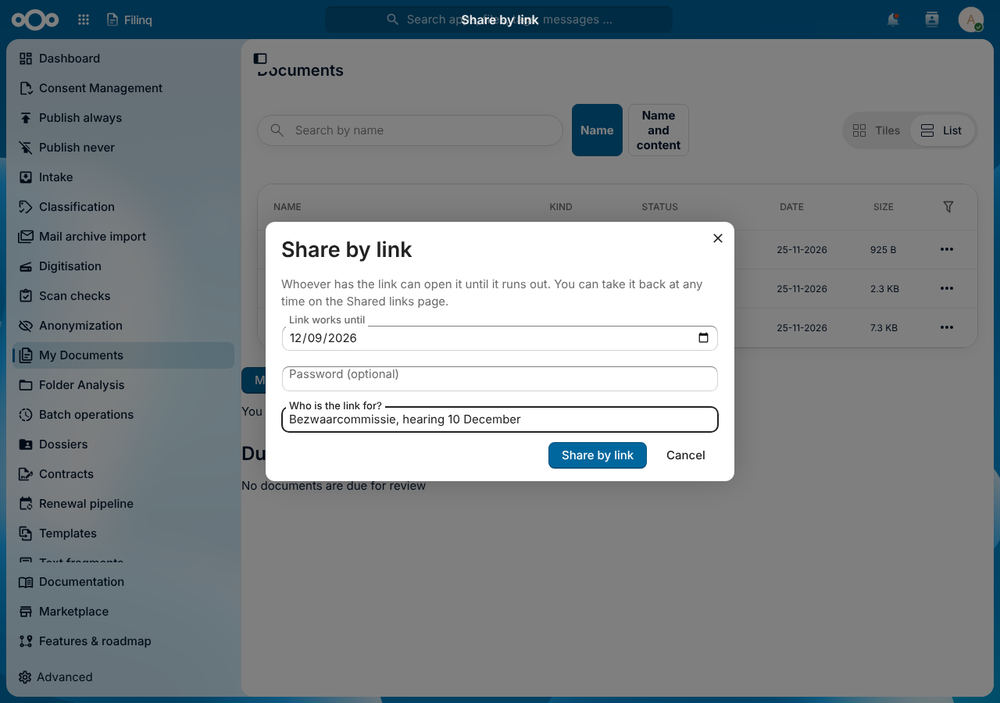
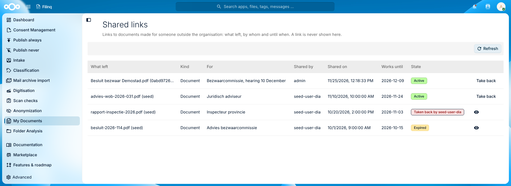

# Sharing documents by a link that runs out

A clerk sends one or several documents to someone outside the organisation,
such as an advisor or the bezwaarcommissie, through one link that stops
working on a set day. The clerk can take the link back at any time, and
filinq records what left, by whom and until when.

Spec: `openspec/changes/archive/2026-11-25-share-document-links` (REQ-SDL-001 to REQ-SDL-006).

## Sharing one document

On **My documents**, open the row menu of a document and choose
**Share by link**. The dialog asks:

- **Link works until**: 14 days ahead by default. When Nextcloud's sharing
  settings enforce a shorter maximum, that maximum wins and the dialog says so.
- **Password**: optional, or required when Nextcloud requires link passwords.
- **Who is the link for?**: a short note, kept on the record.

The link is an ordinary Nextcloud public link with read permission only, so
Nextcloud serves it and protects it. When Nextcloud refuses the share, for
example because the document was shared with the clerk without permission to
reshare, the dialog shows Nextcloud's reason and nothing is shared or recorded.

## Sharing several documents as one bundle

Turn on **Bulk selection**, select the documents and choose
**Share selected by link**. Two or more documents leave as one archive:

- The dialog asks for a name for the bundle, which becomes the archive's name.
- Before anything is built, the dialog says how many files and megabytes the
  bundle holds and, when it goes over the ceiling, which files would be left out.
- The archive holds the documents and a `manifest.json` that lists every file
  included and every file left out with its reason. It is written to
  `DocuDesk/Shared bundles` in the clerk's Files and recorded as an archive job.
  When that job cannot be recorded, nothing is shared.

The archive is a snapshot: a later edit of a document does not change what the
receiver gets.

## Confidential documents

When a document carries a confidentiality label, the dialog names the label
and the share button stays disabled until the clerk confirms that the document
may leave the organisation by link. The label and the confirmation are written
on the record.

## Shared links

**Shared links**, in the options menu of My documents, lists the clerk's links,
or every link for an admin, with what left (each file and its version), who it
was for, the sharer, when it was shared, when it stops working and its state.
The link itself is never shown here.

- **Take back** deletes the Nextcloud share at once, deletes a bundle's archive,
  and marks the record "Taken back" with the clerk's name. Only the person who
  made the link, or an admin, can take it back.
- Once an hour a background job marks links past their date as **Expired** and
  deletes their archives, and marks a link that was deleted in Files as
  **Removed in Files**.

## API

| Route | What it does |
|-------|--------------|
| `POST /api/shares/preflight` | `fileIds`: Nextcloud's link rules, the default expiry, the labels and, for two or more, what the bundle holds. Builds nothing. |
| `POST /api/shares` | `fileIds` (or `fileId`), `name` for a bundle, `expiresOn`, `password`, `note`, `labelConfirmed`: makes the link and answers it with the record. |
| `DELETE /api/shares/{id}` | Takes a link back; 403 for anyone but its sharer or an admin. |

Each route needs a signed-in user and acts as that user. The record is a
`documentShare` object in the filinq register; it holds the Nextcloud share id,
never the link or its token.
