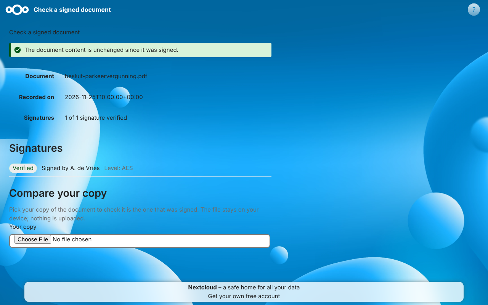
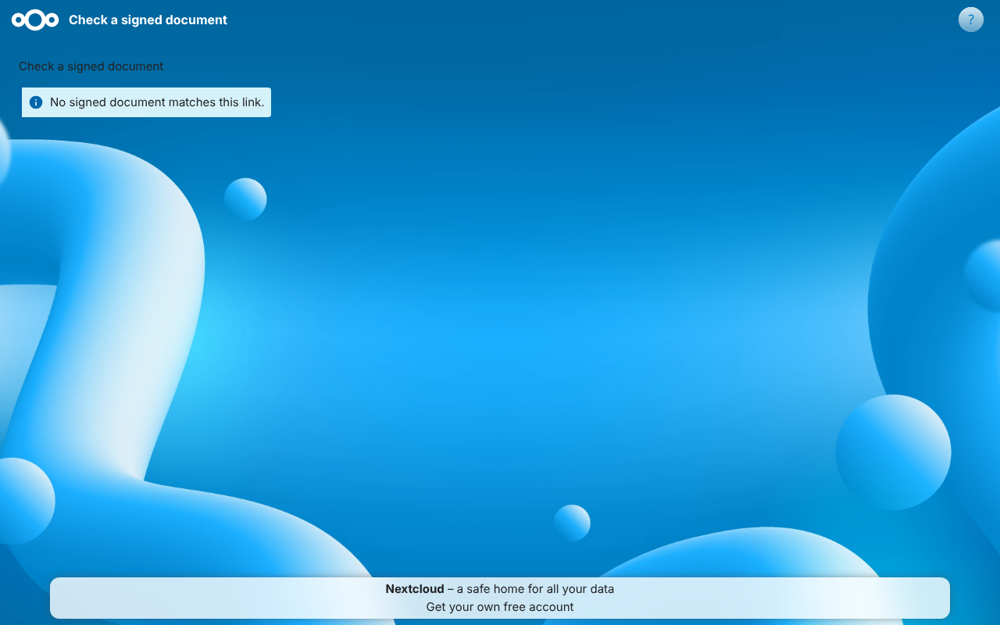

# Signature verification portal

## Overview

Anyone holding a document Filinq signed can check what its signatures
guarantee without a Nextcloud account. When a signing request completes,
Filinq stores the outcome of the signatures under a random token (128 bits,
32 hexadecimal characters) and puts that token on the signing request as
`verificationToken`. The public endpoint answers by token.

## What is built

- **Record**: the `signatureVerification` schema in the `filinq` register
  (register 8.55.0). It holds the file name, the SHA-256 of the signed bytes,
  and per signature its status, level, method, the signer as written in the
  signature, and two separate guarantees. It never holds the document, the
  signing key or a path. Only the server writes it; through the OpenRegister
  API only signing admins read it.
- **Minting**: signing completion reads the stored signed version back as the
  initiator and mints the record. A record that cannot be minted is logged;
  it does not undo the signature.
- **Public endpoint**: `GET /apps/filinq/api/verify/{token}` (public,
  rate-limited, brute-force throttled on every unknown token).

## What the answer says

Two guarantees are reported separately for every signature:

- `integrityVerified`: the document bytes are unchanged since this server
  signed them.
- `identityBound`: the signer fields are covered by the same check, so they
  cannot be rewritten without the check failing. Current (v2) signatures
  cover them; a legacy or external signature does not, and its signer is
  shown only as asserted.

Each signature is `verified`, `invalid` (changed after signing) or
`unverifiable` (an external signature, or one this instance cannot check). An
unverified signature is never reported with either guarantee, whatever the
record says.

A token that names nothing, a malformed token, a revoked record and a store
that cannot be read all answer `200` with `status: unknown` in the same shape,
so the endpoint does not reveal whether a token exists.

A seal named on the record is reported as `unverifiable` with
`seal-check-unavailable`: seal verification is not part of this app yet.

## The public page

A signed PDF carries a QR code with the caption *Verify this document*. It
opens `/apps/filinq/verify/{token}`, a public page that needs no account. The
page reads the verdict from the endpoint above and shows:

- whether the document content is unchanged since it was signed;
- the file name, when the record was made, and how many signatures were
  verified;
- each signature with its status, the signer and the level. A signer that is
  not bound to the signature is labelled *as stated*.

Under **Compare your copy** a visitor can pick their own copy of the document.
The check runs in the browser against the recorded SHA-256; the file is not
uploaded.

A link that names nothing gets the same page with a neutral message, so the
page does not tell a guesser which tokens exist:

The visitor has no account and so no organisation. The one exact-token lookup
therefore runs as the system through `SystemContextSeam`, with its reason
logged. It never lists records and never reads anything but the record the
token names.

The same `verify/...` address also serves the waarmerk page. A signature token
(32 hexadecimal characters) opens this page; a waarmerk code (a UUID with a
check part) opens the waarmerk page. Neither page shadows the other.

## Not built yet

- Minting from the seal path and for LibreSign completions.
