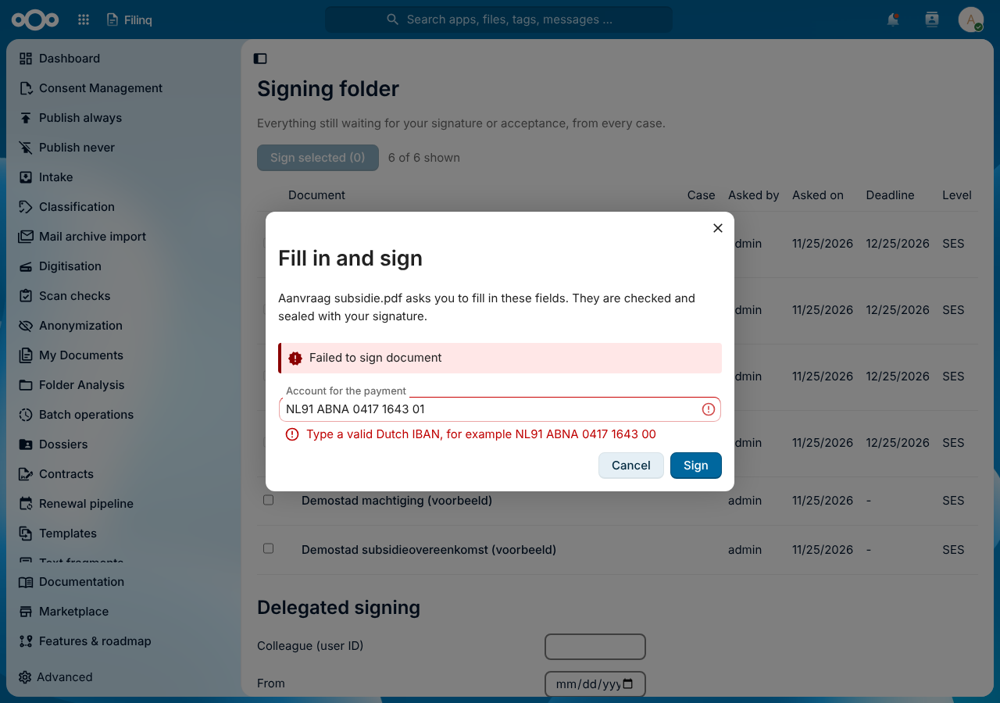

# Place signature fields on a document

A contract has a line for each party's signature on the last page and a box for their initials on every page. Without placed fields the signed document carries its proof at the end of the file and shows nothing on the page. With them, each signer's name, initials and date appear where the document asks for them.

## Place fields

1. Open **Signing requests** and choose **New signing request**.
2. Fill in the document and add the signers.
3. Switch on **Place fields on the document**. The first page of the document appears.
4. Pick a signer and a field, go to the right page, and click where the field goes.
5. Drag a field to move it. With the keyboard: select it, move it with the arrow keys, change its size with Shift and an arrow key, and remove it with Delete.
6. Choose **Create Signing Request**.

Removing a signer row also removes that signer's fields.

## What each field shows

| Field | Shows |
|---|---|
| Signature | The signer's name |
| Initials | The first letter of each word of the name |
| Date | The date the document was signed |
| Name | The signer's name |
| Checkbox | A cross |

The name is the one on the signer's record: the display name, or else the e-mail address, or else the user id.

## Why a moved field is caught

Filinq draws the fields into the pages first and only then computes the signature's check value over the whole document. The fields sit inside what the signature protects. Move a field or change its text afterwards and verifying the document reports it as tampered. The list of placements is part of the signed record too.

A request without placed fields produces exactly the signed document it did before.

## When a request is refused

Filinq checks the fields when the request is created, so a request never reaches the signing step with a field it cannot draw. It answers with an error when:

- a field is on a page the document does not have;
- a field names a signer the request does not have;
- the document cannot be read as a PDF;
- the request goes through LibreSign. LibreSign places its own fields in its own screens, and its request call has no way to pass them on. Send the request without fields, or sign it in filinq.

## Fields the signer fills in

A **Name** field can ask the signer for a value instead, such as the bank account a subsidy is paid to. Select the field in the list under the page and set:

- **Label for the signer**: what the signer is asked, for example "Account for the payment".
- **The signer must fill this in**: the document cannot be signed while the field is empty.
- **Check**: **Dutch IBAN**, **Any IBAN**, or **No check**.

A field the signer leaves empty shows the signer's name, as before.

The checks are run by OpenRegister. When this server's OpenRegister has no IBAN check yet, a request with one is refused with "This check is not available on this server". The check proves the number is a well-formed IBAN, not that the account belongs to the signer.

### Signing a document with fields

In the **Signing folder** a document with fields to fill in says "This document has fields to fill in. Open it to sign." It cannot be signed as part of **Sign selected**. Choose **Fill in and sign**, type the values and choose **Sign**.

Filinq checks every value on the server before anything is signed. A wrong value gets a message on its field, such as "Type a valid Dutch IBAN, for example NL91 ABNA 0417 1643 00", and nothing is signed until every value is accepted. An IBAN is stored in capitals without spaces and drawn on the page in groups of four.

The values are stored on the signer's record, which only signing administrators can read, and drawn into the document inside what the signature protects: changing a value in the signed file afterwards makes verification report the document as tampered. Values never appear in a log line or the audit trail.

An external signer sends the values with the portal sign act, in a `fields` object keyed by the field's position next to `consent` and `signature`.

Next: [send one document to many people](./bulk-send.md).
