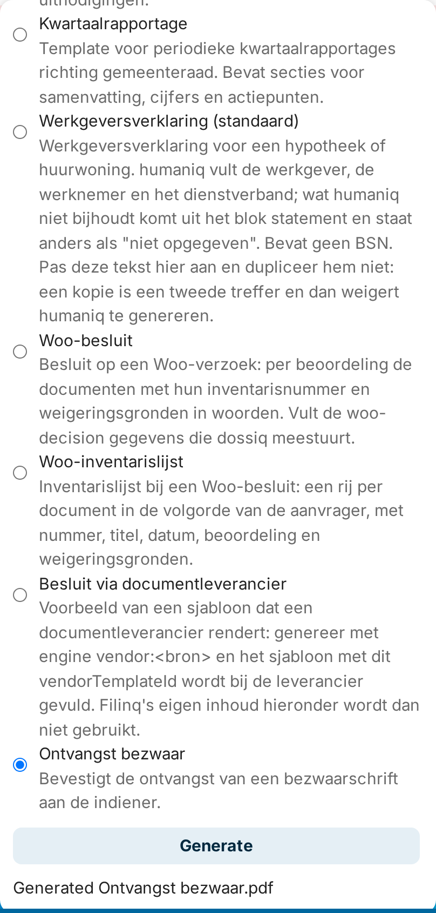

# Make a document from a template on a record

A clerk working on a case in another app needs a letter about that case. They
don't switch to filinq: the case page shows filinq's **Generate a document**
widget. They pick a template and click **Generate**. filinq fills the template
with the case and stores the PDF in the case's folder.

## Which templates show

A template has an optional **scope**: the kinds of record it is meant for, each
named by register and schema (for example `dossiq` / `case`).

- A template **without a scope** shows on every record.
- A template **with a scope** shows only on records of a register and schema in
  that scope. A letter scoped to cases doesn't show on a contract.

Only published templates show. The widget lists each one by name, description
and output format.

## What generating does

- The template is filled with the record the widget sits on. That record is the
  document's data source.
- The generated document records the record it was made from (`sourceObject`),
  so the record's documents can be found again.
- The file goes into the record's folder in Files when the record has one the
  user can reach. Otherwise it goes into filinq's default folder.
- The line under the button names the generated file, or says why it failed.

## For the app that shows it

filinq offers two things through OpenRegister's integration registry:

| Id | What it is |
|---|---|
| `filinq-templates` | The list of templates for a record (`list` only): the rows the widget shows |
| `filinq-generate-document` | The widget, as a card on a record page and as a tab |

A host app places `filinq-generate-document` on its record page. The widget
calls `GET /api/templates/for-object?register=…&schema=…&id=…` and then
`POST /api/documents/generate` with the record as its data source and
`options.sourceObject`.
