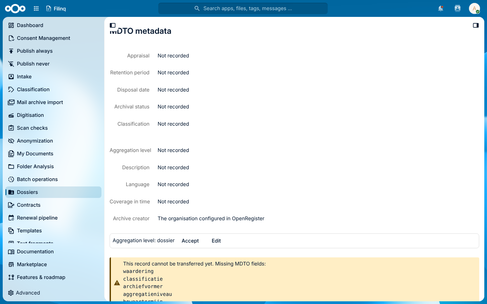
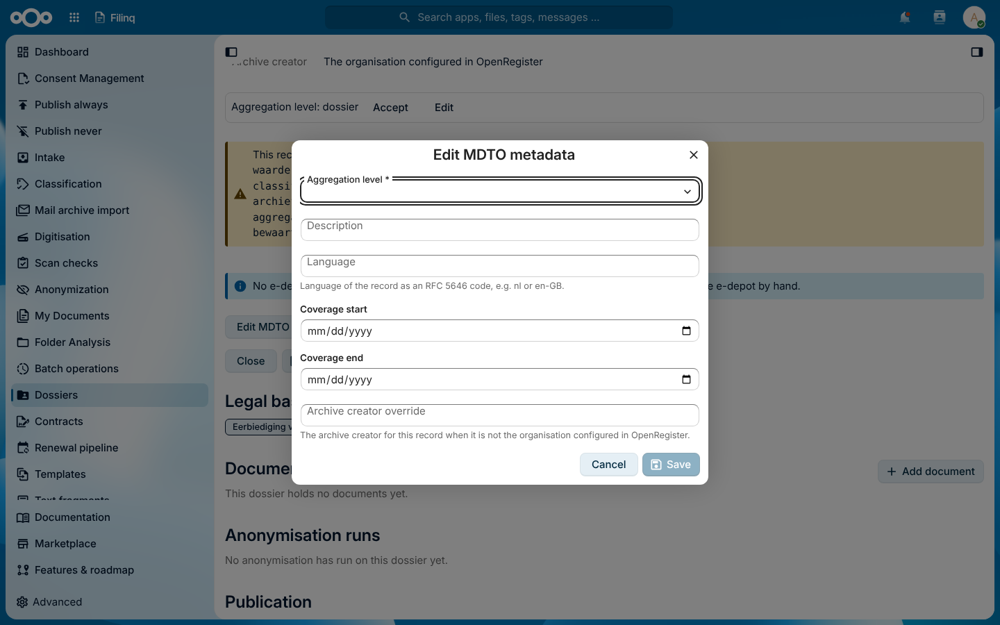
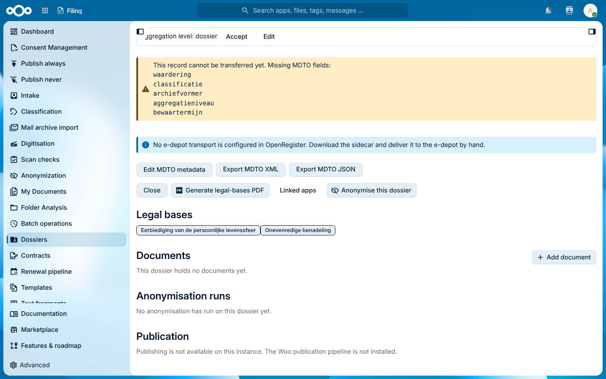

# MDTO archival metadata

## Overview

A record can only go to an archive (archiefbewaarplaats or e-depot) with
standard archival metadata: **MDTO** (Metagegevens voor Duurzaam Toegankelijke
Overheidsinformatie, the Nationaal Archief successor of TMLO). Every document
and dossier in Filinq carries an **MDTO metadata** panel that shows that
metadata, proposes what Filinq can derive, says what is still missing, and
exports or transfers the record.

## The metadata model: core and supplement

The panel shows two lists.

| Part | Fields | Where it is stored |
|---|---|---|
| **Retention core** | Appraisal (waardering), retention period (bewaartermijn), disposal date, archival status, classification | OpenRegister's `retention` field on the record, filled by the retention engine. Filinq does not copy it. |
| **Supplement** | Aggregation level (archiefstuk or dossier), description, language, coverage in time (begin and end), use restrictions (beperkingGebruik), parties (betrokkene), archive creator override | An `mdtoSupplement` object in the document register, one per document or dossier. |

The archive creator (archiefvormer) is the organisation configured in
OpenRegister, unless the supplement sets an override for this record. Fields
without a value read **Not recorded**.

## Proposals: derived values you confirm

Filinq fills in what it already knows, as **proposals**:

- the aggregation level from the record type (a document is an archiefstuk, a
  dossier a dossier);
- the coverage in time from the document or dossier dates;
- use restrictions from Filinq's own state: an unresolved or objected consent
  proposes `avg-persoonsgegevens` with its legal basis, a prohibition match
  proposes `woo-uitzondering` with its legal authority, and an anonymised copy
  adds a note naming it.

Each proposal shows as a row with **Accept** and **Edit**. Nothing proposed is
final until someone accepts it, and an export only contains accepted values.
**Edit MDTO metadata** opens the supplement form for the fields you set by hand.

## Completeness check before transfer

Each record gets a verdict against the MDTO minimum set: identificatie, naam,
waardering, classificatie, archiefvormer, aggregatieniveau, and, for records
that are kept permanently (`bewaren`), dekkingInTijd. While anything is
missing, the panel shows **This record cannot be transferred yet** with the
missing fields, and the transfer is refused. Anything OpenRegister's own MDTO
generator would reject is already reported here as missing, so a record the
check passes never fails in the generator.

## Delivery: through OpenRegister, or by hand

- **With an e-depot transport configured in OpenRegister**, the transfer goes
  through OpenRegister's e-depot transfer service, with the transport and
  profile from its settings. When the e-depot confirms ingestion, the record's
  archival status becomes `overgebracht` and the sidecar is attached to the
  record as a file. Filinq itself holds no e-depot transport or protocol code.
- **Without a transport**, the panel says so (**No e-depot transport is
  configured in OpenRegister**) and offers **Export MDTO XML** and **Export MDTO
  JSON**, so the archivist can deliver the sidecar by hand. It never silently
  does nothing.

## The sidecar

The export is one MDTO XML document in the
`https://www.nationaalarchief.nl/mdto` namespace, with a JSON projection that
carries the same values:

- the core elements, named and mapped as OpenRegister's generator does;
- the accepted supplement elements;
- a `bestand` section for a document: file name, size, format and sha256
  checksum.

A dossier sidecar is an informatieobject at aggregation level `dossier` that
references its member documents as archiefstukken. Exporting the same record
twice without changes gives byte-identical output.

## API

| Method | URL | Description |
|--------|-----|-------------|
| GET | `/api/mdto/{id}` | Completeness verdict, missing fields and proposals for a document or dossier |
| GET | `/api/mdto/{id}/export` | The MDTO sidecar (XML, or JSON with `format=json`) |
| POST | `/api/mdto/{id}/transfer` | Transfer through OpenRegister's e-depot service; refused while the record is incomplete |
