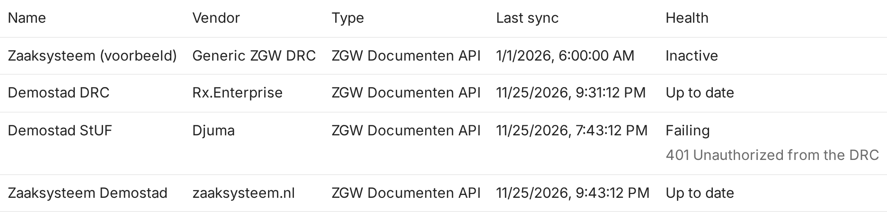
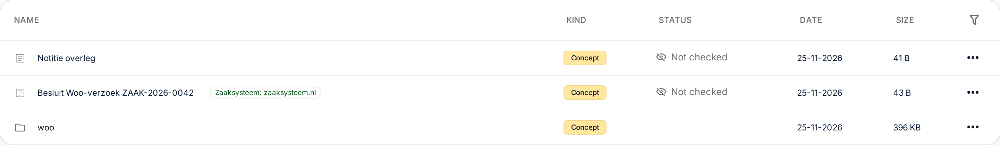

# Documents from a case system

## Status: In progress

Filinq can process documents that live in a case system (a zaaksysteem with a ZGW Documenten API,
such as Rx.Enterprise, Djuma or zaaksysteem.nl). Filinq itself never calls the case system.
OpenConnector does every call in both directions; Filinq reads and writes OpenRegister objects only.

## The master-record boundary

The original document stays mastered in the case system. OpenConnector copies it into Nextcloud as a
**staged** file and records it as an `externalDocument` object with the case system's identifiers,
the zaak it belongs to and the `contentHash` of the copy. Filinq never changes or deletes the staged
file, and deleting anything in Nextcloud never deletes anything in the case system.

What Filinq produces from it (an anonymised version, for example) goes back as a **new**
informatieobject related to the same zaak. The original in the case system is never overwritten.

## The lifecycle of an external document

| Status | Set by | Meaning |
|---|---|---|
| `staged` | OpenConnector | The copy is in Nextcloud, waiting for someone to pick it up. |
| `in_processing` | Filinq | An operator attached it to a dossier; the dossier holds a working copy. |
| `processed` | Filinq | The result file is recorded in `resultFileRef`. |
| `ready_for_writeback` | Filinq | An operator released the result for the case system. |
| `written_back` | OpenConnector | The result is in the case system, its id in `resultExternalId`. |
| `writeback_failed` | OpenConnector | The push failed; the reason is in `writeBackError`. A retry returns it to `ready_for_writeback`. |

The schema declares these transitions, and Filinq refuses any other move.

Attaching a staged document to a dossier copies the staged file into the dossier's folder (under a
free name when the name is taken) and records the dossier on the external document. The existing
anonymisation flows then work on that copy, never on the staged original.

## Configuring OpenConnector

Filinq expects two synchronisations in OpenConnector, configured by the administrator:

- **Pull** from the case system's Documenten API: create `externalDocument` objects in Filinq's
  register as `staged`, upload the file into Nextcloud, and after each run write `lastSyncAt`,
  `lastSyncStatus` and, on failure, `lastSyncError` on the matching `bridgeSource` object.
- **Push** watching `ready_for_writeback`: create a new informatieobject related to the same zaak
  (title suffixed "(geanonimiseerd)", a relation to the original's identificatie, Filinq's
  processing metadata), then set `written_back` with `resultExternalId`, or `writeback_failed`
  with `writeBackError`.

## Case system sources in the admin settings

The **Case system sources** section of Filinq's admin settings lists every source with its vendor,
type, last sync and health. A source is **Up to date** when it synced successfully in the last
24 hours, **Not synced in the last day** when it did not, **Failing** when its last run failed (with the error under it)
and **Inactive** when it is switched off. Without any source the section explains that sources are
configured in OpenConnector.

## The source badge

A file that came from a case system carries a badge **Zaaksysteem: {vendor}** in My Documents and in
the file viewer's header. A file made in Nextcloud has none. My Documents looks the badges up once per
page, not once per row.

## Not built yet

Running anonymisation on the dossier copy does not yet record the result on the external document
(`processed` with `resultFileRef`); until it does, that step is recorded through OpenRegister.
